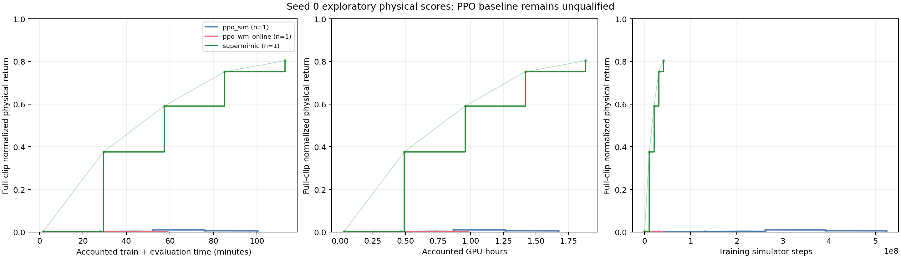
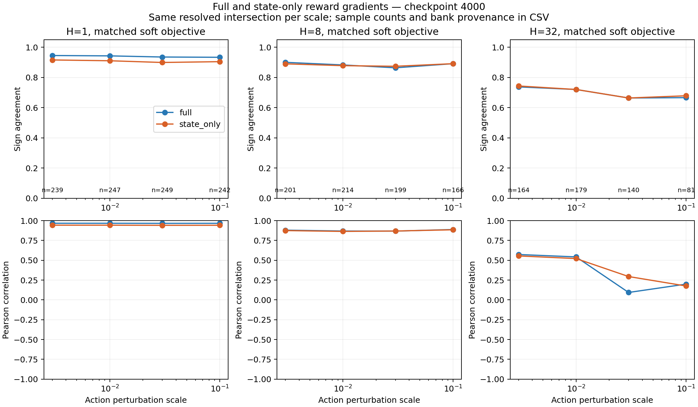
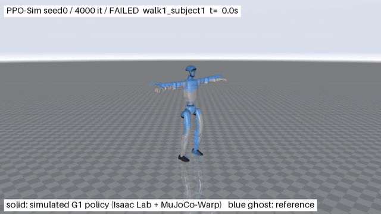

# SuperMimic 复现与 World Model / PPO / BPTT 消融

[English](README.md) · [实验协议](docs/ablation/protocol.md) · [完整运行命令](docs/ablation/runbook.md)

用同一个 Unitree G1、LAFAN1 动作库和物理评估协议，比较直接在 MuJoCo-Warp 中训练的 PPO、在 Learned World Model 中训练的 PPO，以及 WM+BPTT+Critic，判断效率收益来自模型 rollout 吞吐、模型梯度，还是两者的组合。

这是论文的**非官方独立复现**。本分支新增实验脚本，不修改原 `supermimic/` 训练入口。

## 已经得到什么结果

**目前尚无多种子效率结论。** 4000次迭代单种子、18段walk/run/sprint中，SuperMimic的物理Return达到0.8035，失败2/18；原参数PPO仍全部失败；调整Actor学习率后，PPO-Sim在1000轮达到0.2528、失败12/18。开发seed0仅用于调参，正式seeds1/2/3已预登记。原生Smoke、短程Pilot和64状态梯度诊断均已完成，冻结WM配对尚未完成。正式结果仍需至少3个训练seed和全部40段动作。

| 实验 | 已验证的结果 | 证据 |
|---|---|---|
| 长程探索（seed0） | BPTT第4000轮物理Return=0.8035，失败2/18；训练与五次物理评估共1.8824 GPU-hours。PPO基线尚未合格，不能归因或排名 | [已完成物理评估与成本](results/ablation/formal-seed0-partial/evaluations.csv) |
| PPO参数选择（seed0） | Actor lr=2e-5、1000轮：三次物理复评均值0.252798、失败12/18；尚非完整长程或多seed结论 | [调参范围与预登记](docs/ablation/ppo-qualification.md) |
| 原生统一对照 | Pilot共7个训练进程、30次物理复评、540条逐clip记录；所有最终策略均提前失败，不能排名 | [Return与完整成本CSV](results/ablation/pilot-v1/evaluations.csv) |
| Prediction / Gradient Fidelity | 已训练collector、64状态；最终WM在ε=.03的H1/H32完整奖励方向符号一致率0.936/0.664，resolved交集249/140条。前向精度与梯度质量分别检验 | [配对统计与限制](docs/ablation/results.md) |
| 目标规模资源测量 | 4096环境下，PPO-Sim / 在线PPO-WM / BPTT实测峰值显存约8.25 / 12.13 / 23.08 GiB | [资源估算与执行条件](docs/ablation/runbook.md) |



仅绘已完成物理评估点，单seed不绘制标准差带；原PPO参数未合格，不能把曲线差距直接归因于算法。中间横坐标为checkpoint计时加累计复评成本的回溯重建，不是现场在线评估时序；完整方法端点使用进程分配。冻结方法另全额计入WM预训练。



本图固定第4000轮策略采集64状态，比较同一WM的完整奖励与去掉直接动作平滑项的辅助目标。短时域的方向一致性高于H32，长时域结果也更依赖扰动尺度。有限差分只是数值参考；state prediction accuracy、gradient fidelity和最终policy performance分别检验。四个WM阶段的MSE持续下降，但沿梯度微步的物理改善并非单调增加；这仍是单seed探索，不是因果或显著性结论。

梯度入口使用 `--prefix-controller policy` 连续保留观测历史与previous action，full/state_only配对按状态库内容SHA256核验；原 `reference_pd` 模式保留作控制。新实验六个探针已完成，共0.188922 GPU-hours，collector的物理失败率仍为2/18。接触稳定组在H32仅有3状态，不能据此作可靠的分组结论。[数据与收据](results/ablation/trained-policy-fidelity-seed0-v1/) · [命令与边界](docs/ablation/runbook.md)。

### 本次消融的真实失败轨迹



PPO-Sim，seed0，第4000次迭代；`walk1_subject1` 的前6秒，正常速度，实心为物理仿真、蓝色为参考。2.42秒触发跟踪终止后保持真实终止姿态，未用reset后的姿态替换。它是单独录制的复评，分数和成本不混入主曲线；所有18段在该复评中均失败。[诊断与复现](docs/ablation/ppo-qualification.md)。

### 原仓库作者的跟踪演示


实心机器人是仿真策略，蓝色是参考动作。**这是原仓库已有演示，不是本次消融策略的效果。** 原作者报告40段LAFAN1、RTX PRO 6000、迭代14000、约1.47小时、Return=0.829、0/40失败；这些数值不能与本次A100/18段实验直接混比。本次消融的真实失败轨迹另行记录，不能用这段成功动图替代本次验收。

## 先运行一个最小实验

需要Linux、NVIDIA GPU、固定Isaac Lab / Newton / MuJoCo-Warp环境，以及完整40段G1动作与机器人资产。建议先从原生Smoke开始，完整矩阵需数小时；不要直接复制正式配置启动长训练。

原仓库Docker安装入口见[英文README](README.md#setup)。本次A100使用独立Python环境和Torch CUDA12.8构建；固定提交、资产转换、依赖声明限制见[环境复现](docs/ablation/environment.md)。安装命令不是已完成验收，须先验证原生状态/FK/reset。

在仓库根目录、已准备好的原生Python环境中运行：

```bash
python -m unittest discover -s tests -v
python tools/test_env.py --num_envs 32
python tools/test_reset.py
python -m experiments.ablation.run_suite \
  --phase smoke --output logs/ablation/my-smoke \
  --gpu 0 --max-gpu-hours 0.75 --seeds 0
python -m experiments.ablation.validate_run logs/ablation/my-smoke
```

成功后应看到`campaign.json`为completed、`validation.json`通过、各方法`train.csv`和逐checkpoint的`per_clip.csv`完整。**这只说明链路成立，不表示策略已经学会跟踪。** 输出目录不可覆盖，失败证据会保留。

## 六个条件分别回答什么

| 配置中的method | 训练数据与优化 | 要回答的问题 |
|---|---|---|
| `ppo_sim` | 物理rollout + PPO | 直接仿真的基线成本 |
| `ppo_wm_online` | 持续物理采集、拟合WM、imagined PPO | WM吞吐是否抵消模型学习成本与偏差 |
| `supermimic` | 同样在线WM，BPTT+Critic | 原方法整体收益 |
| `ppo_wm_frozen_hard` | 固定WM、硬终止PPO | 冻结模型的系统成本 |
| `ppo_wm_frozen` | 固定WM、软终止PPO | 与下行进行同WM优化器配对 |
| `bptt_wm_frozen` | 同一WM/replay/初始mean/critic，BPTT | 相同模型上模型梯度的收益 |

PPO仅给原mean网络增加29个可训练log-std，策略损失不通过WM动力学反传。硬/软终止、随机/确定性动作、起点分布等剩余差异在[协议](docs/ablation/protocol.md)中逐项披露。相同学习率不等于相同调参质量。真实批次重放已发现 Actor 更新过大；独立学习率控制通过 KL 检查，尚待长程学习验证，见 [PPO 资格记录](docs/ablation/ppo-qualification.md)。

新运行器支持每个 checkpoint 的多次独立物理复评，单独记录其波动和全部费用；复评次数不能算作训练 seed 数。[重复评估与有界 PPO 调参](docs/ablation/ppo-qualification.md#有界长程验证与重复评估)。

两个1000轮PPO候选均完成，各9次物理复评：lr=5e-6/2e-5最终Return均值0.013086/0.252798，失败18/12段，合计1.6260 GPU-hours。恢复器在原执行源码和原预算下补齐资源门禁中断的评估，未重训。正式验证选用2e-5、排除开发seed0；六条件×seeds1/2/3的保守估算为94.17 GPU-hours，分批上限32/seed，总上限96。这是计划预算，不是已经运行的结果。[结果、预登记与运行命令](docs/ablation/ppo-qualification.md#两候选完成与正式参数冻结)。

Prediction Error–Policy Performance图也按checkpoint内容匹配并汇总全部复评，分别展示1/8/16/32步误差；缺失复评会拒绝绘图，单次评估不伪造标准差。[旧Pilot的四时域关联图与CSV](results/ablation/prediction-performance-v2/)仍显示全部策略跟踪失败，只是观察性关联，不能证明低MSE带来更好控制。

所有方法最终在真实物理模拟器中评估。主要曲线使用完整motion归一化Return，对墙时、GPU-hours和Simulator Steps分别作图；不把imagined return当物理成绩。

## 查看、复现和继续实验

- [实验配置](experiments/ablation/configs)：Smoke / Pilot / 正式参数；seed0用于开发，正式seeds1/2/3，18段walk/run/sprint后扩至全部40段。
- [运行手册](docs/ablation/runbook.md)：训练、独立复评、预算估算、固定库预测误差和梯度诊断。
- [阶段结果](docs/ablation/results.md)：实际硬件、样本数、失败、数值参考筛选和未完成范围。
- [源论文](https://arxiv.org/pdf/2610.28480)：第3/4节及相关附录；Figure 5(b)是训练回报对imagined steps，不能直接替换本项目的端到端物理曲线。

代码沿用[MIT许可证](LICENSE)及原作者归属。LAFAN1动作和机器人资产的来源、独立许可证与引用见[英文README](README.md#attribution-and-licenses)；本仓库不重新分发训练动作数据。
