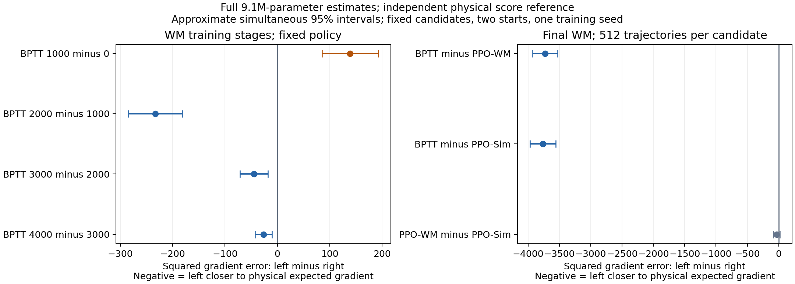
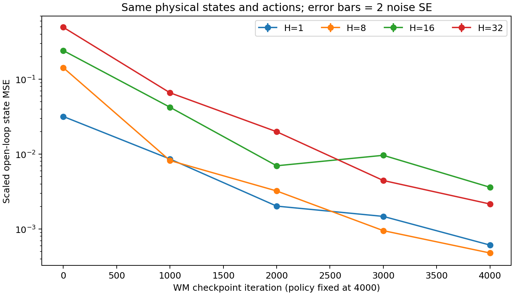
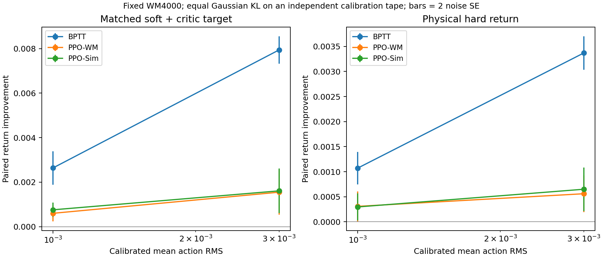

# Forward 准确不保证 Policy 梯度准确：实测结果

2026-10-26；原生 MuJoCo-Warp，单张 A100-PCIE-40GB。本轮新增 **0.564808 GPU-hours**，含资源资格、两次失败和恢复。

## 现在能够回答什么

**这两个判断可以同时成立：forward 变准，梯度仍可能变差；在给定模型、任务和有限采样预算下，BPTT 的梯度又可能比 PPO 的采样梯度更准确。** 本轮对这两件事分别做了测量，没有从训练成绩倒推梯度准确性。

1. **一个实际反例**：保持 Policy/Critic 不变，把 WM 从 update0 换到 update1000，H32 prediction MSE 从 **0.493789 降到 0.065932**，误差缩小约7.49倍；但完整 Policy 梯度对物理期望梯度的平方误差差值为 **+138.69，近似同时95%区间 [+84.91,+192.47]**，反而更差。update0是未训练模型；这是从未训练到部分训练的反例，不是两个成熟模型的比较，也不代表梯度方向一定变差。
2. **最终模型上的有限样本优势**：相同 Policy、目标和每种方法512条采样轨迹下，WM4000的 BPTT 完整梯度平方误差低于 PPO-WM 和 PPO-Sim；两项差值分别为 **−3729.85** 和 **−3764.38**，同时区间均小于0。PPO-WM 对 PPO-Sim 的差异未解析。
3. **物理更新也有收益**：把三种更新校准到相近的 Gaussian KL（主尺度约0.00145），独立物理评测的硬 Return 改善为 **BPTT +0.001071、PPO-WM +0.000309、PPO-Sim +0.000297**。这是单次局部更新结果，不是完整训练曲线或效率排名。

因此，“SuperMimic 击败 PPO，所以 WM 梯度一定更准”这个推论本身不成立。更严谨的表述是：**这次直接的梯度比较支持 BPTT 在当前有限采样条件下更接近物理目标梯度，而且等 KL 小步更新更有效；它的低采样方差可以与残留模型偏差同时存在。** 还不能给出整个 SuperMimic 训练收益中 rollout 加速和模型梯度各占多少的比例。



横轴是左方法减右方法的平方误差，负值表示左方法更好。区间只覆盖独立参考的 Monte Carlo 波动，条件是本次候选梯度固定；不覆盖训练种子、起点分布、数值误差和目标选择。

## 控制了哪些变量

| 项目 | 实际设置 |
|---|---|
| 机器人与物理环境 | Unitree G1，MuJoCo-Warp3.15.0；相同资产、nominal xi、状态恢复和噪声协议 |
| 固定策略 | seed0 / update4000，原mean网络共9,116,477个参数，Critic固定 |
| 策略分布 | 两种梯度估计都使用同一个Gaussian mean网络，固定σ=0.1；本诊断不训练log-std |
| WM | 同一训练轨迹的0/1000/2000/3000/4000快照及各自normalizer；不重训 |
| 起点 | run1_subject2、run1_subject5各一个固定起点，保留raw history；每起点16副本，batch32 |
| 梯度目标 | H32，原actor公式的soft-survival + frozen-Critic bootstrap；硬物理Return另外评测 |
| BPTT | 对随机策略重参数化，经WM反传完整Policy参数 |
| PPO-Sim / PPO-WM | θ_old处首次score gradient，λ=1，无advantage标准化/entropy；rollout和target全部detach |
| 梯度采样 | seeds61001..61016，各32轨迹，共512条/估计器 |
| 物理评测 | seeds71001..71016，各32轨迹；配对共同随机数 |
| 独立梯度参考 | 新seeds101001..101064，共2048物理轨迹；不与候选梯度样本重合 |
| 数值设置 | FP32，TF32关闭，eager，相同batch shape；CUDA12.8 / Torch2.11.0+cu128 |

512条轨迹是两个起点的噪声重复，**不是512个独立状态，也不是512个训练seed**。五个WM属于同一条训练轨迹。Critic来自原确定性策略训练，没有为本次Gaussian score estimator重新拟合；它会影响PPO方差。这里的PPO梯度不是完整多epoch、重新拟合Critic、调参后的PPO算法。

## Prediction Error 与梯度准确性分别测量

所有模型使用同一组物理状态及实际动作做open-loop预测。状态坐标固定尺度为[p .3, rotation .4, v 1, w 3.14, q 1, qd 10]，不随WM的normalizer变化；以下是scaled MSE，完整噪声SE在CSV中。

| WM训练迭代 | H1 | H8 | H16 | H32 |
|---|---:|---:|---:|---:|
| 0 | 0.031817 | 0.142632 | 0.241243 | 0.493789 |
| 1000 | 0.008608 | 0.008218 | 0.042279 | 0.065932 |
| 2000 | 0.002024 | 0.003225 | 0.006992 | 0.019927 |
| 3000 | 0.001475 | 0.000952 | 0.009646 | 0.004446 |
| 4000 | 0.000611 | 0.000479 | 0.003611 | 0.002159 |



H32误差逐阶段下降，但不能据此预设梯度误差也单调下降。H16的2000→3000甚至没有改善；不应把单一时域误差称为模型整体准确性。

### 物理梯度参考从哪里来

原中央差分检验保留：8个独立输出bias方向，ε=.001/.003/.01，分别仅 **0/8、1/8、2/8** 通过预设信噪比和跨尺度筛查。主尺度绝大多数方向无法解析，不能把它们当ground truth算一个有利的“准确率”。这些方向只覆盖29维bias子空间。

于是增加了独立物理score参考，明确作为补充终点。固定系数1构造：

```text
g_reference = g_score(physics) − g_score(WM4000) + g_BPTT(WM4000)
```

若同一WM随机目标满足微分与期望交换，后两项的期望抵消，参考仍针对物理期望目标。并不是把WM梯度直接当真值。三项使用共同噪声减少方差，但64组参考噪声与候选梯度独立；系数没有根据结果拟合。实测完整向量的参考方差是原始物理score的 **7.12%**。原始物理score及其SE也全部公布，七项差值的符号与修正参考相同；其区间更宽。

为避免估计未知真实梯度的平方范数，对两条已经固定的候选梯度A/B计算：

```text
error(A) − error(B) = ||A||² − ||B||² − 2 g_physics · (A − B)
```

64组独立参考分别给出这个标量，再对预先列出的7项比较使用共同重采样的max-|t| bootstrap（10000次，seed111001）构造近似同时95%区间。这比较的是完整9.1M参数向量的**条件平方误差，包含幅值与方向**；不能称为方向余弦、梯度符号准确率或模型Jacobian真值。

| 左估计 − 右估计 | 平方误差差值 | 近似同时95%区间 |
|---|---:|---:|
| BPTT1000 − BPTT0 | +138.69 | [+84.91, +192.47] |
| BPTT2000 − BPTT1000 | -232.95 | [-284.32, -181.58] |
| BPTT3000 − BPTT2000 | -44.88 | [-71.51, -18.24] |
| BPTT4000 − BPTT3000 | -26.39 | [-42.32, -10.46] |
| BPTT4000 − PPO-WM4000 | -3729.85 | [-3928.87, -3530.82] |
| BPTT4000 − PPO-Sim | -3764.38 | [-3971.50, -3557.26] |
| PPO-WM4000 − PPO-Sim | -34.53 | [-86.22, +17.16] |

从1000到4000，后续三个阶段的forward和梯度误差同时改善。这与0→1000的反例一起说明：**Prediction Error是有用的模型指标，但不能替代Gradient Fidelity测量**。本次不能辨识该反例究竟来自模型Jacobian的哪个部分、Critic的作用还是误差累积。

最终WM的候选梯度均值范数 / 均值采样SE的L2：BPTT **11.713 / 0.231**，PPO-WM **62.422 / 56.520**，PPO-Sim **62.779 / 55.732**。这支持PPO估计在当前预算下噪声很大；没有测出充分采样后的PPO期望梯度排名。在同一WM、同一随机目标上，pathwise和score理论上估计同一个期望梯度，有限样本性质不同。

## 沿这些梯度更新，物理Return如何变化

原主批次保留11个完整均值方向、3个相同参数L2步长。L2=.003时，BPTT4000/PPO-WM4000/PPO-Sim的硬Return改善分别为+0.014612/+0.002112/+0.002922，但相同参数步长不等于相同策略变化。

补充用独立seed91001的物理输入tape校准动作均值变化。σ固定时，动作RMS=.001/.003对应Gaussian KL约.00145/.01305；实际KL逐项保存在CSV中，动作RMS匹配容差1%。**该KL只对声明的校准输入分布成立，不是更新后整条轨迹的KL。** 更新方向是完整均值梯度，不是带历史moments的Adam训练步骤。

| 方法 | 目标动作RMS | 硬物理Return改善，均值 ± noise SE |
|---|---:|---:|
| BPTT4000 | 0.001 | +0.001071 ± 0.000161 |
| BPTT4000 | 0.003 | +0.003369 ± 0.000168 |
| PPO-WM4000 | 0.001 | +0.000309 ± 0.000149 |
| PPO-WM4000 | 0.003 | +0.000561 ± 0.000182 |
| PPO-Sim | 0.001 | +0.000297 ± 0.000135 |
| PPO-Sim | 0.003 | +0.000650 ± 0.000217 |



图中误差条为2个noise SE；噪声以16个batch统计，不假装为训练seed标准差。软目标与硬Return分开绘制。本批BPTT在两种尺度上的平均收益均更大，但不能把这种局部差异换算为整段motion的学习速度倍数。

最小动作RMS=.0003时，三种方向的参数扰动相对舍入误差分别为2.449%/2.392%/2.393%，都超过预注册2%门槛；三项标记unresolved，不做物理更新、不放宽阈值。其余六项通过校准及物理重放验收。全部512个主评测窗口均为switch_nearby，**没有stable-contact对照，不能给出接触稳定与接触切换的组间结论**。

## 资源、失败与可复现性

| 实际分配 | 秒 | GPU-hours | 结果 |
|---|---:|---:|---|
| 初次入口 | 1.814 | 0.000504 | argparse Path序列化失败，未初始化物理rollout |
| 同batch资源资格 | 136.452 | 0.037903 | 成功；不混入正式统计 |
| 五WM主批次 | 1551.967 | 0.431102 | 成功 |
| 独立参考与首次校准 | 223.212 | 0.062003 | 64组参考成功；最小校准失败，进程失败完整保留 |
| 校准恢复 | 119.863 | 0.033295 | 复用原64组参考，6项成功、3项无法解析 |
| **合计** | **2033.308** | **0.564808** | 同一个1 GPU-hour累计上限 |

每次启动前检查GPU UUID、空闲显存、活动进程和磁盘。主批次预估2271.7秒，显存预留16GiB；参考/校准恢复启动前重新计算剩余额度，未重置预算。最大设备占用3834MiB（包含设备上下文的采样值，不是精确tensor峰值）。累计完成物理steps **1,658,880**，imagined steps **1,759,232**；失败参考进程的82,944物理steps由已完成校准/16基线/64参考阶段重建，账本明确标注其证据类型。

本轮复用已有WM和Policy，无新增WM训练；模型生产成本仍在原训练账本，不能因这里复用checkpoint而称WM免费。该费用是诊断预算，不是方法训练预算。此前收敛诊断0.605553 GPU-hours和更早匹配实验0.310986 GPU-hours仍单列；三批合计1.481347 GPU-hours，不包含其他历史训练/诊断费用。

原生执行源码按阶段为`c04862a`（主批次）、`b04e6c2`（独立参考）、`0f705e1`（校准恢复）。完整输入SHA、软件信息、逐条命令、原生日志、资源检查与失败日志位于[原始数据包](../../results/ablation/checkpoint-audit-v1/raw-data.tar.gz)；[清单](../../results/ablation/checkpoint-audit-v1/artifact-manifest.json)逐文件绑定SHA256。[资源CSV](../../results/ablation/checkpoint-audit-v1/resource-accounting.csv)包含全部五次分配。

约401MB/份的候选完整均值和146MB物理参考均值保留在原GPU主机，路径/SHA写入清单；发布包不含这些大文件。已在CPU读取大文件复核全部向量范数、bias切片、方差守恒和14项误差差值恒等式，验证回执与脚本随包提供。公开的小文件足以复算全部CSV与图，但独立重验完整向量还需要这些保留的大文件。训练checkpoint和受许可约束的动作资产未随结果包重新分发。

### 不需要GPU的结果复算

在仓库根目录，用已安装Torch CPU、NumPy、Matplotlib的Python执行：

```bash
mkdir -p work/checkpoint-audit-replay
python - <<'PYCODE'
import tarfile
with tarfile.open('results/ablation/checkpoint-audit-v1/raw-data.tar.gz') as archive:
    archive.extractall('work/checkpoint-audit-replay', filter='data')
PYCODE
python -m experiments.ablation.analyze_checkpoint_audit \
  --input work/checkpoint-audit-replay/primary/experiment \
  --output work/checkpoint-audit-replay/analysis --verify-native
python -m experiments.ablation.analyze_calibrated_updates \
  --input work/checkpoint-audit-replay/calibrated/experiment \
  --parent work/checkpoint-audit-replay/primary/experiment \
  --output work/checkpoint-audit-replay/calibrated-analysis
python -m unittest discover -s tests -p 'test_native_checkpoint_publication.py' -v
```

测试核验压缩包与逐文件身份，重新计算CSV、校准KL、原始物理收益、完整步骤覆盖和费用谱系；所有发布CSV要求逐字节一致。完整CPU测试182项通过。科学图已目视检查。

### 原生实验入口

需要原生Isaac Lab/Newton环境、motion/机器人资产、指定checkpoint目录和原始bank。以下是入口形式，真实执行绝对路径和环境详见包内campaign/probe记录；重跑必须使用新目录且重新检查资源，不能覆盖原证据。

```bash
python -m experiments.ablation.run_checkpoint_audit \
  --plan experiments/ablation/configs/checkpoint-audit-v1.json \
  --checkpoint-directory "$AUDIT_CHECKPOINT_DIR" --bank "$AUDIT_BANK" \
  --output "$AUDIT_NEW_OUTPUT" --gpu 2
python -m experiments.ablation.run_calibrated_updates \
  --parent-campaign "$AUDIT_NEW_OUTPUT" \
  --output "$AUDIT_NEW_CALIBRATED_OUTPUT" --gpu 2
```

若某次补充已完成参考而校准失败，只能在核验记录与累计费用后使用`--resume-failed`；本次实际恢复命令已保存在日志中。新机器不能沿用旧GPU UUID或旧资格结论。科学设计见[预注册协议及补充记录](checkpoint-audit-protocol.md)。

## 已验证、观察与未完成

- **已验证的执行与数据**：五WM预测误差、三种匹配梯度链路、实际物理rollout、独立参考、完整向量复核、六项校准更新、失败/未解析项与全部费用；原`supermimic/`训练流程保持原样。
- **有统计支持的条件性观察**：本次0→1000的forward/梯度反例；最终WM的固定512轨迹估计中BPTT平方误差更低；等校准KL下BPTT平均物理改善更大。它们针对单训练seed、两个run起点和指定目标。
- **尚未证实**：PPO充分采样或重拟合Critic后的差异；模型偏差与采样方差的完整分解；接触组差异；三个独立训练seed、全部40段motion的泛化；端到端等质量计算效率；rollout加速与模型梯度对总训练收益的比例。

本轮已经为用户提出的具体问题提供直接实验答案。原始三方法、多训练seed、全40段的完整研究计划仍需另行完成，不能以本报告代替。
