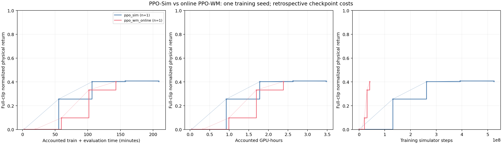
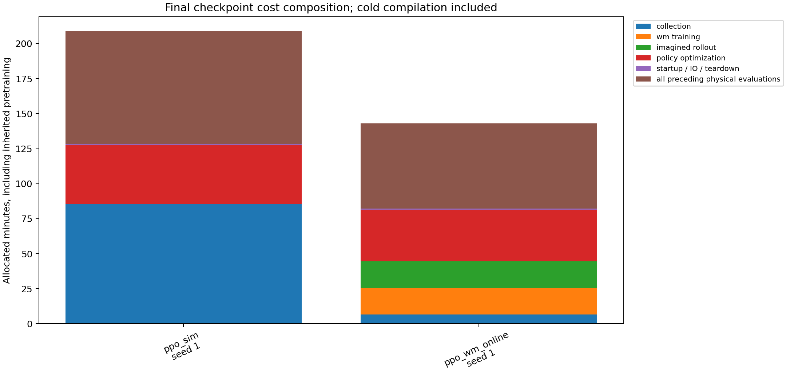
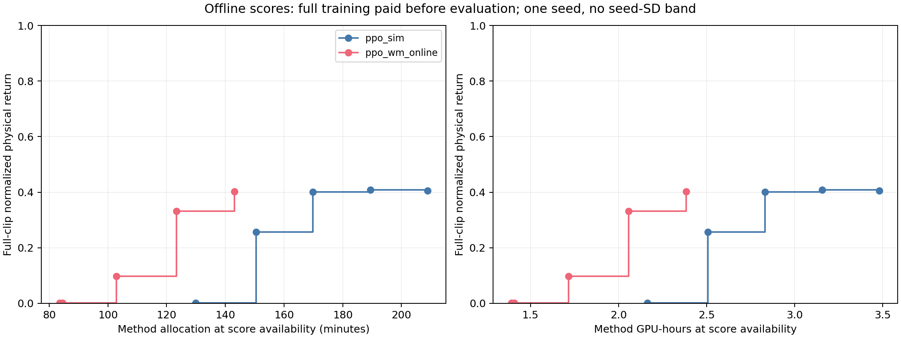

# 正式 seed 1：PPO-Sim 与在线 PPO-WM

两个方法均完成4000轮及五个checkpoint的三次物理复评。**在线PPO-WM的最终记录费用较低，物理Return数值接近PPO-Sim；这是一训练seed的观察，尚不能证明质量等价或多seed效率优势。** 预登记Return门槛0.5/0.7/0.8均未达到，不报告达到同等质量的加速比。

| 最终第4000轮 | PPO-Sim | 在线 PPO-WM |
|---|---:|---:|
| 物理Return，三次复评均值 | 0.405211548 | 0.402736068 |
| 复评样本SD | 0.008720951 | 0.000003435 |
| 三次失败段数（共18段） | 7 / 5 / 6 | 5 / 5 / 5 |
| 平均失败率 | 33.3333% | 27.7778% |
| 完整训练 GPU-hours | 2.140929299 | 1.369835295 |
| 全部物理评估 GPU-hours | 1.340805483 | 1.014381890 |
| 方法总 GPU-hours | 3.481734781 | 2.384217185 |
| 训练 Simulator Steps | 524550144 | 41222144 |
| Imagined Steps | 0 | 458752000 |
| 物理评估 Simulator Steps | 2952504 | 2142180 |
| WM Training Time（秒） | 0 | 1117.408173 |
| Policy Optimization Time（秒） | 2539.253530 | 2217.976378 |
| 训练峰值设备显存（MiB） | 8450 | 12422 |

两者使用同一A100 40GB、同一物理GPU UUID、G1、LAFAN1 locomotion18、4096环境、H32/k8、FP32/TF32设置及源码`3526437`；数据、模型资产、训练/评估源码和协议哈希一致。正式seed为1，开发seed0未混入。PPO Actor学习率为2e-5；必要的随机策略和log-probability适配保持相同。PPO-Sim执行4000轮策略更新；在线PPO-WM包含500轮WM预热和3500轮策略更新，**相同迭代上限不是相同优化工作量**。



曲线仅绘实际checkpoint物理评分，粗阶梯为最后观测值保持，浅线连接原始点帮助阅读，不表示中间性能已测得；单训练seed不绘训练seed标准差带。中间时间轴由checkpoint计时加累计复评费用回溯重建，最终点使用完整进程分配，不能解释为现场已取得分数的时刻。



在线PPO-WM完整训练费用包括物理采集397.659811秒、WM训练1117.408173秒、imagined rollout 1155.542515秒、策略优化2217.976378秒及其余42.820184秒。WM学习成本没有遗漏。两方法均未使用共享冻结预训练，其0.080170277 GPU-hours保留在campaign账本，但不加入这两个方法的独立费用。

阶段吞吐：PPO-Sim物理采集约102538 steps/s；在线PPO-WM物理采集约103662 steps/s、imagined约397001 steps/s。它们的分母分别是对应采集/rollout阶段时间，不是端到端训练时间，不能据此直接算策略学习加速。

在线PPO-WM的方法总分配费用低31.52%，训练Simulator Steps少92.14%。这是当前预算和一个训练seed的描述性比较。物理评估时间也受轨迹长度与提前失败影响；更低费用不自动等于更高跟踪质量。PPO-Sim三次复评有可见波动，原因未定位，所有重复均保留；三次复评SD不是独立训练seed SD。



流水线先完成每个方法的全部训练，再评估所有checkpoint。上图从完整训练费用开始，累加之前及当前的物理复评；这是方法子进程分配之和，不包括其他方法、排队和编排间隙，不是绝对日期或纯学习效率。两种时间口径分开提供，避免把离线回溯当在线反馈。

## 验收与复现

冻结原始包含72个文件、两方法8000行训练CSV及日志、30次物理评估和540条逐motion记录。逐文件SHA、CSV/stdout逐项一致、每次逐motion与总体回报/失败率、32个选定方法进程费用和最终端点均核对。原始包解包后生成的9份CSV/JSON字节一致；故意缺少最后一次复评时，在产生输出前拒绝。原PPO-Sim发表包保持不变。

```bash
mkdir -p work/ppo-pair-reproduction
tar -xzf results/ablation/confirmatory-seed1-ppo-pair-v1/raw-data.tar.gz \
  -C work/ppo-pair-reproduction
python results/ablation/confirmatory-seed1-ppo-pair-v1/reproduce.py \
  work/ppo-pair-reproduction/confirmatory-seed1-ppo-pair-v1 \
  --output work/ppo-pair-reproduction/analysis
python -m unittest discover -s tests -p test_recorded_ppo_pair.py -v
```

复算只需要Python、NumPy和Matplotlib，无需GPU、MuJoCo或模型权重。[原始包](../../results/ablation/confirmatory-seed1-ppo-pair-v1/raw-data.tar.gz) · [原始输入SHA](../../results/ablation/confirmatory-seed1-ppo-pair-v1/input-sha256.json) · [验收收据](../../results/ablation/confirmatory-seed1-ppo-pair-v1/verification.json) · [物理结果和完整费用](../../results/ablation/confirmatory-seed1-ppo-pair-v1/evaluations.csv) · [分数可用时费用](../../results/ablation/confirmatory-seed1-ppo-pair-v1/score-timing.csv) · [预登记门槛](../../results/ablation/confirmatory-seed1-ppo-pair-v1/registered-targets.csv)。

## 仍未证实

三独立训练seed、同WM下BPTT/PPO完整配对、全40段正式性能及正式多seed Gradient Fidelity尚未完成。本批记录与费用验收不替代整个六条件campaign结束后的原生checkpoint张量验收。seed1早期存在同主机CPU/磁盘工作重叠，保留全部费用，未扣除推测干扰或剔除seed。

当前数据可以支持“此单seed的在线PPO-WM记录费用更低”；不能支持“WM普遍更划算”“BPTT优势已被分离”或“更低Prediction Error导致更好策略”。三张PNG/SVG已实际生成并检查可读性；`figure-qa`依赖的检查脚本未安装，未宣称期刊级自动验收。
