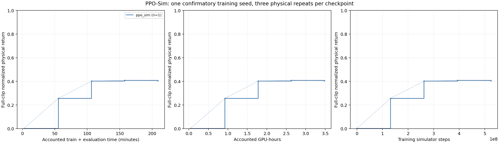
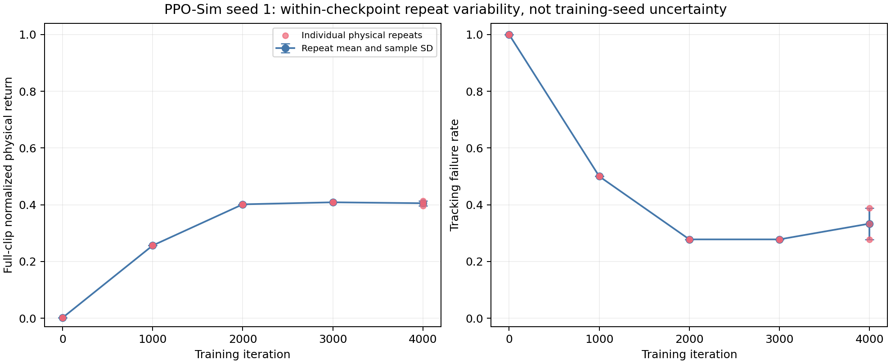
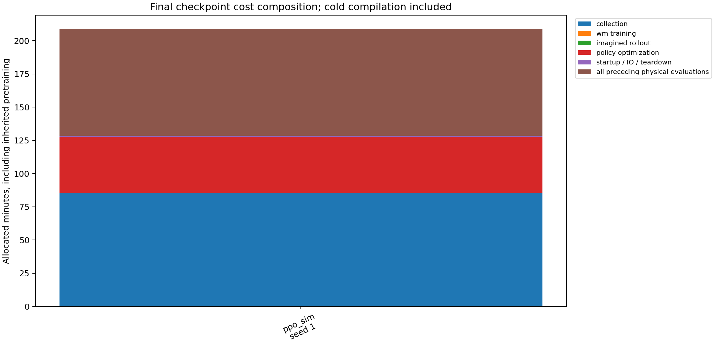

# 正式 seed1 PPO-Sim：完成训练与15次物理复评

2026-10-24，正式验证seed1的PPO-Sim完成4000轮训练、五个checkpoint各三次新进程物理复评，共270条逐motion记录。**这是一个方法、一个训练seed的完整记录，不是完整六条件或三seed结论。** 其他方法及seeds2/3仍在执行队列中。

同一A100-PCIE-40GB（GPU UUID `GPU-aa15d3ab-4db3-2464-bff6-af4d7e78c4c9`），G1、18段LAFAN walk/run/sprint、4096环境、H32、Actor lr=2e-5。训练及物理评估固定执行提交`3526437a50fdc714cc77bc4527ca70124770b08a`；分析代码与执行源码分离。

## 物理结果

| 训练迭代 | Return三次均值 | 复评样本SD | 三次失败段数 / 18 | 累计训练+复评GPU-hours |
|---:|---:|---:|---|---:|
| 0 | 0.001491294 | 6.72124e-11 | 18 / 18 / 18 | 0.038057 |
| 1000 | 0.256170839 | 2.59811e-07 | 9 / 9 / 9 | 0.925434 |
| 2000 | 0.401386013 | 5.13027e-07 | 5 / 5 / 5 | 1.777900 |
| 3000 | 0.408540746 | 1.22746e-06 | 5 / 5 / 5 | 2.628445 |
| 4000 | 0.405211548 | 0.00872095 | 7 / 5 / 6 | 3.481735 |

SD描述同一个checkpoint在新进程中的复评波动，不能作为独立训练seed标准差。所有物理结果均保留，未选择较好复评或把第3000轮替换为最终checkpoint。均值曲线的n=1指一个训练seed；图中不绘训练seed标准差带。



中间横坐标是checkpoint训练快照加此前复评分配的回溯核算，评估实际在完整训练后执行，不代表现场分数可用时刻。最终点使用完整训练和评估进程时间。不同GPU、任务集合、开发seed0及训练回报没有混入本图。

## 最终checkpoint的复评差异

三次Return为0.396050721、0.413413346、0.406170577；失败数7、5、6。最终均值0.405211548，复评样本SD0.008720951；平均失败率33.3333%，复评SD为5.5556个百分点。相较早期checkpoint，本点的复评差异明显增大。



三次的checkpoint、训练/评估manifest、源码、GPU和物理协议身份一致。前两次失败差异涉及`run2_subject1`与`walk1_subject5`。已核对对应执行源码：评估固定Torch种子，使用Policy均值输出、nominal仿真参数并关闭reset噪声；TF32允许、AMP为none。**具体波动原因尚未定位**，这些检查不能证明逐位确定性，也不能直接归因于接触、TF32或某个求解器。没有增加诊断GPU运行或更改正式协议。

## 完整成本

训练完整进程7707.345475秒（2.140929 GPU-hours），15次物理评估4826.899738秒（1.340805 GPU-hours），合计**12534.245213秒 / 3.481735 GPU-hours**。训练峰值设备显存8450 MiB。

训练账本记录Simulator Steps=524550144、Imagined Steps=0；采集5115.649319秒、策略优化2539.253530秒、WM训练0秒。初始化、I/O、退出等剩余52.442626秒计入完整训练分配。采集phase吞吐约102538 steps/s，不是端到端吞吐。评估物理步数2952504另列，含评估共527502648 steps。



共享WM预训练没有被PPO-Sim使用，其0.080170 GPU-hours保留在原campaign总账，不加到本方法成本。本数据包保留的是仍在运行的campaign原始快照；分析只选取已成功完成的PPO-Sim训练及15次复评，不把其他方法未完成费用计为零或宣称整个campaign结算完毕。

seed1前段曾与同主机其他GPU资源测试和必要归档重叠。所有实际时间保留，不能宣称CPU/磁盘隔离，也不扣除估算干扰。只有完整三seed对照才能评估方法间端到端效率，当前不报告加速比或算法排名。

## 原始数据与CPU复算

[原始数据包](../../results/ablation/confirmatory-seed1-ppo-v1/raw-data.tar.gz)包含37个原始文件：4000行训练CSV、训练日志、配置/manifest/completion、原campaign快照、15份评估JSON和15份逐motion CSV，以及分析所需的预训练completion。大型checkpoint仍在远端，路径和内容哈希见原始记录；此包用于分析复算，不声称包含模型权重。

在仓库根目录执行，只做CPU分析，不启动训练：

```bash
mkdir -p work/ppo-seed1-reproduce
tar -xzf results/ablation/confirmatory-seed1-ppo-v1/raw-data.tar.gz \
  -C work/ppo-seed1-reproduce
python results/ablation/confirmatory-seed1-ppo-v1/reproduce.py \
  work/ppo-seed1-reproduce/confirmatory-seed1-ppo-v1 \
  --output work/ppo-seed1-reproduce/figures
```

复算核对37个输入SHA256、连续训练迭代、全部15次复评及逐clip汇总、源码/设备身份和16个独立费用分配。实际解包复算得到7份字节一致的CSV/JSON输出；移除最后一次评估文件后，在产生输出前拒绝。三张PNG已逐图检查图例与标注。[验收记录](../../results/ablation/confirmatory-seed1-ppo-v1/verification.json) · [数据与费用资格](../../results/ablation/confirmatory-seed1-ppo-v1/qualification.json) · [逐clip CSV](../../results/ablation/confirmatory-seed1-ppo-v1/per-clip-evaluations.csv) · [逐进程费用](../../results/ablation/confirmatory-seed1-ppo-v1/process-allocations.csv)。

这里验证的是单方法训练与物理记录、身份和费用；包含实际checkpoint张量的整批原生验收仍须等待完整campaign，严格三seed汇总门禁未放宽。正式训练配置和命令见[运行手册](runbook.md)与[预登记方案](../../experiments/ablation/configs/confirmatory-locomotion-plan.json)。
