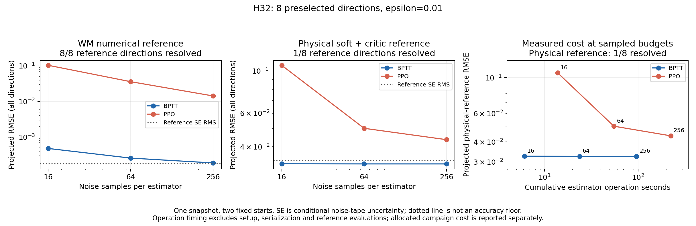
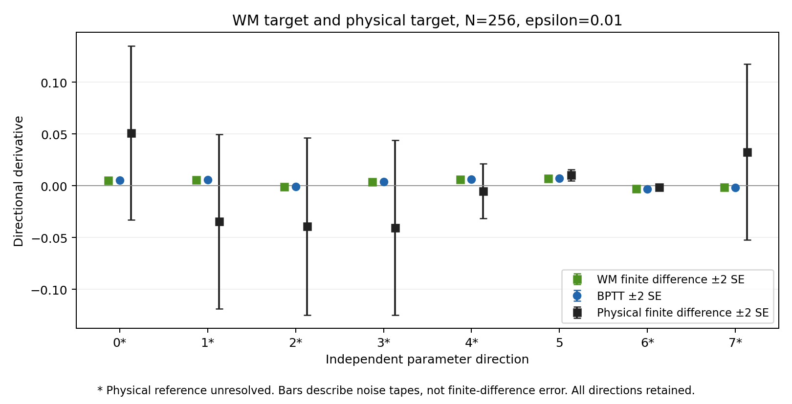

# 独立随机方向实验：BPTT 更稳，但物理梯度准确率仍未定

**实验已完成。当前证据支持：在同一个 WM 目标和本次采样预算内，BPTT 比 PPO score gradient 更稳定、更接近 WM 自身的数值导数。它还不能支持“WM 反传给 Policy 的梯度在物理环境里普遍更准”。** 原因不是没有执行物理实验，而是预设主尺度下，物理有限差分只有 **1／8** 个方向通过可靠性筛查。

这次比较的是同一 WM 上的两种梯度估计器，不是完整 SuperMimic 与 PPO-Sim 的训练排名。原始数据、所有失败筛查方向和三个扰动尺度均保留；没有删掉大差分来改善结论。[协议与原生运行命令](estimator-convergence.md) · [数据、CSV 与 CPU 复算命令](../../results/ablation/estimator-convergence-v1/README.md)。

## 实际执行了什么

固定训练 seed 0、update 4000 的 Policy／WM／Critic，两个原始 run 起点，H32 和全部 9,116,477 个 Actor 参数。两种估计器都使用相同 mean 网络、固定 Gaussian σ=.1，以及相同 soft survival + Critic bootstrap 目标。Critic 没有为辅助随机策略重新拟合。

- 先生成 **8 个与梯度无关的随机单位参数方向**，再计算梯度。
- BPTT 与 PPO 使用配对噪声，样本数依次为 **16、64、256**；每份 tape 包含两个固定起点。
- 使用另外 **32 份独立参考噪声**，分别在 WM 和 MuJoCo-Warp 中测量正负参数扰动；ε=.003、.01、.03，主尺度预先固定为 .01。
- 主批次完成 **1570 次物理 rollout + 1570 次 WM 参考 rollout**，每次为两个起点各 H32 步。后续又执行三次单方向数值复评，单独记账。

硬终止物理 return 同时保存在原始数组及逐 tape CSV 中；它与 soft+critic 代理目标不同，不拿它直接给代理目标梯度评分。

这些 noise seeds 不是训练 seeds；两个起点不是完整状态分布。PPO 是旧策略处的首次 score gradient，λ=1、无 advantage 标准化／entropy／可学习 σ；不包括生产 PPO 的多轮裁剪优化。测量的是完整 actor 目标梯度，不是纯 WM 动力学 Jacobian。

## WM 内部：BPTT 的采样优势成立

以下是全部八个独立方向上的投影 RMSE，参考为 WM 的中央差分，ε=.01。RMSE 越小，表示在这些方向上越接近 WM 自身的数值导数。

| 噪声样本数 N | BPTT RMSE | PPO RMSE | BPTT 计算秒数 | PPO 计算秒数 |
|---:|---:|---:|---:|---:|
| 16 | 0.00047844 | 0.10393931 | 6.12 | 13.85 |
| 64 | 0.00025647 | 0.03602491 | 23.82 | 55.19 |
| 256 | 0.00018755 | 0.01430956 | 96.28 | 223.28 |

WM 参考的八个方向在三个尺度下全部通过筛查。N=256 时，BPTT／PPO 的符号一致数分别为 **8/8、6/8**，Pearson 为 **0.99946、0.58137**；这仍只是八个投影的描述性统计。

PPO 增加采样后误差明显下降，但不能称为已充分收敛：其全向量均值 L2 为 **56.53**，均值 SE 的 L2 尺度仍为 **55.87**；BPTT 对应为 **11.81、0.223**。这里的 SE 描述固定快照和起点上的 Monte Carlo 波动，不是训练 seed 的标准差。

计算秒数包含各自 imagined rollout 与梯度计算，排除了初始化、序列化和参考评估。这是 eager、两个起点的小批次实现，不能将数值比例当成生产 PPO 或端到端训练的加速倍数。

## 物理参考：目前无法给准确率排名

| 参数扰动 L2 | WM 参考通过筛查 | 物理 soft+critic 参考通过筛查 |
|---:|---:|---:|
| .003 | 8/8 | 1/8 |
| .01，预设主尺度 | 8/8 | 1/8 |
| .03 | 8/8 | 0/8 |

筛查同时要求：信号超过重复噪声、相邻尺度导数足够一致，以及参考均值超过两倍参考采样 SE。它是操作性筛查，不是解析真值认证。

主尺度下，BPTT／PPO 相对物理参考的全部方向 RMSE 分别为 **0.03253／0.04360**，但参考自身的 SE RMS 就有 **0.03380**。不能把这个误差比解释成物理梯度准确度的提升倍数。只有一个方向可判读，也不报告有意义的物理 Pearson 排名或用“1/1”包装高准确率。

唯一通过的方向 5：BPTT 预测 **0.007313 ± 0.000077 SE**，物理参考 **0.010212 ± 0.002782 SE**，PPO 预测 **0.028605 ± 0.018839 SE**。这一点与 BPTT 局部吻合相容，但不足以代表全部参数空间。

## 对大差分做了额外复评，没有删除它

主批次中，noise seed **40027** 在五个方向产生约 ±1.34 的大差分估计。我们随后固定原方向 0、两个原始起点和相同噪声，在三个新进程中重复原尺度网格；seed 40001 作为控制。该复评是**观察结果后选择的诊断**，不是新的独立确认样本，也不替换主批次。

下表为 seed 40027、方向 0 的物理代理目标方向差分，先对两个起点取均值：

| ε | 主批次 | 复评 1 | 复评 2 | 复评 3 |
|---:|---:|---:|---:|---:|
| .003 | 0.004133 | 0.004252 | 0.004133 | 0.004013 |
| .01 | 1.347291 | 1.347291 | 1.347327 | 1.347363 |
| .03 | 0.452952 | 0.452960 | 0.452960 | 0.452940 |

**大响应可以复现，但导数估计随尺度剧烈变化。** 在第二个起点，ε=.01 和 .03 的正负代理回报差都约 .0538；除以不同的 2ε 后，方向差分自然发生大幅变化。这说明这些尺度上的响应不能被当作稳定的局部线性导数。尚未定位是接触事件、轨迹分叉、终止机制还是 solver 数值行为所致；不能直接归因于 WM 偏差。

主批次物理初态恢复漂移为 0；同一基线 tape 的重复代理回报最大变化为 4.77e−7；参数扰动的最大相对 L2 舍入偏差为 0.0641%。这些检查通过，也没有消除上述尺度依赖。[逐 tape、逐起点原始 CSV](../../results/ablation/estimator-convergence-v1/analysis/reference-tapes.csv)和[复评 CSV](../../results/ablation/estimator-convergence-v1/analysis/reference-audit.csv)均可重算。

## 成本、验证与结论边界

| 部分 | 分配 GPU 秒数 | GPU-hours |
|---|---:|---:|
| 初始资源探针 | 81.980 | 0.022772 |
| 完整冻结批次 | 1979.923 | 0.549979 |
| 三次事后数值复评 | 118.088 | 0.032802 |
| 合计 | **2179.992** | **0.605553** |

总计 5 个原生进程，均成功退出；同一 A100 GPU2，峰值设备显存 3042 MiB，低于原 **1 GPU-hour** 上限。合计 107,008 simulator steps、34,048 梯度估计 imagined steps、107,008 WM 参考 imagined steps。费用包含初始化、数据保存与清理；没有重训 WM 或更新 Policy。既有 checkpoint 训练费用和以前的诊断账本分别保留，不能把这里的费用当成完整训练成本。

CPU 从原始数据重新计算全部指标和 CSV，检查完整梯度均值的范数与全部随机方向投影、固定状态、输入哈希、费用及三次复评身份；未初始化 CUDA。163 项测试、编译检查及文件差异检查通过。原生 source 固定为 `5e1ac4548334a3dcbdccdaafb60683dae86905f5`，主批次和复评原始数据分别封存。

- **已验证**：独立方向对照和 N=16/64/256 采样链路、物理扰动、完整费用及原始数据复算；本设置下 BPTT 的 WM 内有限采样估计更稳定。
- **观察性结果**：PPO 随采样增加接近 WM 数值参考，但 N=256 仍噪声较大；物理差分的少数大响应可复现且强烈依赖尺度。
- **尚未证实**：WM 对真实物理梯度的普遍准确性优势、这些大响应的物理或数值根因、全参数向量准确率、跨状态与训练 seed 的稳定性。本轮固定 WM，没有直接测试跨 checkpoint 的 Prediction MSE—Gradient Fidelity 关系，也不能完成 WM 吞吐加速与 BPTT 对完整训练效率的归因。

因此，“SuperMimic 的控制表现更好”仍不能直接换成“WM 的物理梯度比 PPO 的梯度准确很多”。这次实际测到的优势，首先是**给定 WM 目标与采样预算下的估计效率**。
