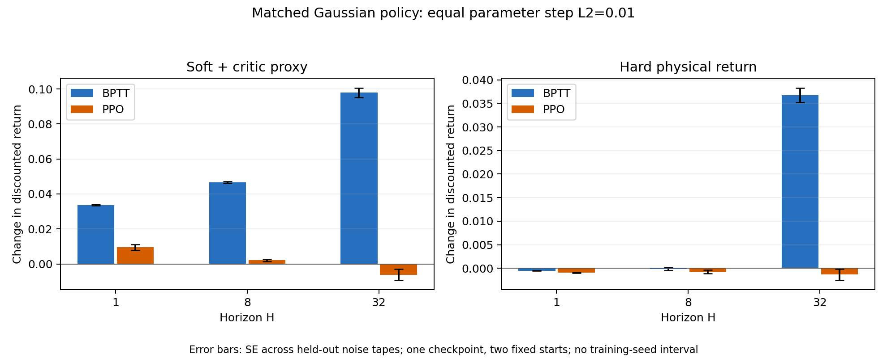

# 同策略同目标的 BPTT / PPO 梯度对照：第一批物理结果

修复后的 H1/H8/H32 已全部完成。**在同一 checkpoint 的两个 run 起点、固定 Gaussian σ=.1、相同采样量和参数步长下，H32 的 BPTT 平均梯度方向带来明确的条件性物理收益；PPO 平均梯度方向没有显示明确的正向收益。** 这批小样本的 PPO 梯度估计方差很大，不能从方向差异直接推出 WM 的完整梯度更准确，也不能据此排名完整训练算法。

## 比较了什么

原生执行固定为 `3c294d1cdf6e1153da2e79b9292e2b586b69c177`。Policy/WM/Critic 与 raw-history bank 沿用[确定性参数梯度实验](policy-gradient-native-v1.md)；训练 seed0 checkpoint、`run1_subject2` / `run1_subject5` 两个起点不变，没有新训练 WM。

两种方法同用原 Policy mean 和固定 σ=.1；BPTT reparameterize Gaussian 动作，PPO 只通过 log-prob 求导。H1/H8/H32 各使用 16 个梯度噪声 seeds9001–9016，每个 tape 包含两个起点；每种估计器每个 horizon 共32条 imagined trajectory。另使用互不重叠的16个物理噪声 seeds19001–19016做共同随机数正负扰动，ε={.001,.003,.01}，包含3次同 tape 数值复评。所有 Policy/WM/Critic/normalizer 冻结，TF32关闭、AMP无、eager。

PPO 是 θ_old 处的首次 clipped-surrogate 梯度，λ=1、无 advantage 标准化、无 entropy、无可学习 std；它恢复原目标按时间求和的单位。参数更新沿16个估计的均值方向，单位 L2归一化后施加相同 ε，**没有使用 Adam**。它不是生产 PPO 的完整多 epoch优化；原确定性 Actor 和历史 Adam 结果继续独立保留。[数学定义、源码与命令](matched-policy-estimators.md)。

## 采样方差

这里的 variance trace 是固定起点平均目标的参数梯度样本协方差迹；SE L2 是均值估计标准误向量的 L2尺度。噪声 tape 不等于训练seed，两个固定起点也不能代表状态分布。

| H | 估计器 | 梯度均值 L2 | Variance trace | 均值 SE L2 |
|---|---|---:|---:|---:|
| 1 | BPTT | 3.475597 | 0.152436 | 0.097608 |
| 1 | PPO | 32.066084 | 15234.296929 | 30.856824 |
| 8 | BPTT | 5.274602 | 0.857864 | 0.231552 |
| 8 | PPO | 102.163344 | 238794.926258 | 122.166619 |
| 32 | BPTT | 11.715814 | 10.818107 | 0.822272 |
| 32 | PPO | 235.628121 | 733762.413178 | 214.149833 |

PPO 的均值估计误差尺度与均值向量范数相近或更大，说明当前样本不足以把它当作稳定的期望梯度。只观察两种均值的 cosine 很小，不能区分模型偏差和采样误差。这里不将方差比例当成训练加速倍数；GAE、advantage标准化、更大batch、Critic质量和多epoch更新会改变生产 PPO 的行为。

在允许交换期望与微分等条件下，统一策略和可微 WM 目标后的两种估计器针对同一个 `∇E[J_WM]`；有限采样表现不同，并不说明两个理论期望梯度不同。这是随机计算图梯度恒等式在本设计中的解释，见 [Schulman 等 §2.1](https://arxiv.org/pdf/1506.05254)。它也不保证 `∇E[J_WM]` 等于物理目标梯度。

## 匹配代理目标的方向导数

以下只看 BPTT 均值选择的单位方向，ε=.01；数值参考是16个独立物理噪声tape的均值，±表示这些tape之间的SE。

| H | BPTT 预测 | PPO 预测 | 物理中央差分 ± SE |
|---|---:|---:|---:|
| 1 | 3.475597 | 6.125950 | 3.540185 ± 0.059698 |
| 8 | 5.274602 | 7.599811 | 5.054459 ± 0.045901 |
| 32 | 11.715814 | 1.892237 | 11.952429 ± 0.235830 |

这些 BPTT 方向通过了当前ε/重复噪声筛查；在其他方向上仍存在差异。H32 的 PPO 方向未通过ε稳定性筛查，不能把它的差分当作可信精确参考。仅两条由梯度样本选择的方向，不报告有意义的全参数空间Pearson相关性；原始CSV包含两种预测沿两条方向的全部尺度，不能把H1/H8/H32不同目标混起来计算相关性。

有限差分是数值参考，SE只描述噪声tape采样误差；接触切换、有限ε与舍入误差并不因此消失。三次同tape基线重复噪声为零，不等于差分无误差。方向本身来自有限梯度样本，选择效应也不能忽略。

## 相同参数步长的真实收益

以下 ε=.01，±为16个独立物理噪声tape的SE。每个H各自计算不同的方向；不是同一次更新的三个轨迹前缀。

| H | 更新方向 | Δ代理目标 ± SE | Δ硬终止物理 Return ± SE |
|---|---|---:|---:|
| 1 | BPTT | +0.033677 ± 0.000409 | -0.000510 ± 0.000035 |
| 1 | PPO | +0.009519 ± 0.001674 | -0.000862 ± 0.000097 |
| 8 | BPTT | +0.046719 ± 0.000490 | -0.000105 ± 0.000294 |
| 8 | PPO | +0.002139 ± 0.000641 | -0.000686 ± 0.000364 |
| 32 | BPTT | +0.097928 ± 0.002658 | +0.036755 ± 0.001523 |
| 32 | PPO | -0.006119 ± 0.003144 | -0.001321 ± 0.001187 |

H1 的代理目标改善仍伴随硬物理回报下降；H8 硬回报变化相对采样SE很小；H32 的 BPTT 方向有正向物理收益。这些都是固定两起点下的观察。**较吻合的代理方向导数不保证给定有限步长能提高硬物理回报；较好的物理更新也不证明完整梯度向量准确。**

Return 是H步折扣和，不能与完整18/40段物理评估的归一化Return混比。对当前随机目标、两个起点的统计不代替3个独立训练seed，更不能作为完整PPO与SuperMimic的最终效率排名。

## 实现修复、验证与费用

初版 H32 seed9009 的 θ_old 检查失败；独立审计发现参数前后 SHA256相同，batch64重算log-prob相对原逐步batch2偏差1.04904e-4，保持逐步形状则逐值相同。修复后采用 `torch.equal` 更严格的检查，并在新目录重新运行全部3个horizon。失败、审计和旧资格结果均保留；不以放宽容差接受失败结果。

本阶段共7个原生进程：初版H1/H8两个成功、初版H32一个失败、一次数值审计、修复版三个成功；总分配 **509.385011 秒 / 0.141495836 GPU-hours**。加上前15组确定性诊断，累计 **0.310985655 GPU-hours**，低于同一累计上限0.5，未重置失败成本。使用独立A100 GPU2、CPU76–79与独立checkout；正式GPU0队列继续，不能据此假设共享主机干扰严格为零。

原始梯度、均值/方差、物理rollout、独立noise组、CSV和状态库完成CPU交叉复核；分析/绘图用时24.719秒，未初始化CUDA。原始向量保留实验主机，SHA256/大小清单随小包交付。此费用是诊断成本，不是重新训练模型的端到端成本，不并入正式训练效率曲线。

[完整数据与复算命令](../../results/ablation/matched-policy-v1/README.md)。CPU回归覆盖解析Gaussian期望、H8因果权重、H1 Critic Bootstrap、共同随机数有限差分、PPO数据断图、批次形状、独立噪声与原生数据复算。

已验证：同目标估计器与真实物理对照链路成立；本批条件下BPTT采样波动较小，H32等步长更新有物理收益。尚未证实：PPO均值的充分采样收敛、全参数空间准确率、跨状态/接触/WM阶段/训练seed的稳定性，以及WM加速与优化方式对完整训练的最终贡献。下一步仍需更广held-out起点与接触分组、独立随机参数方向及更多梯度噪声样本；正式三seed/40段训练结果另行验收。
