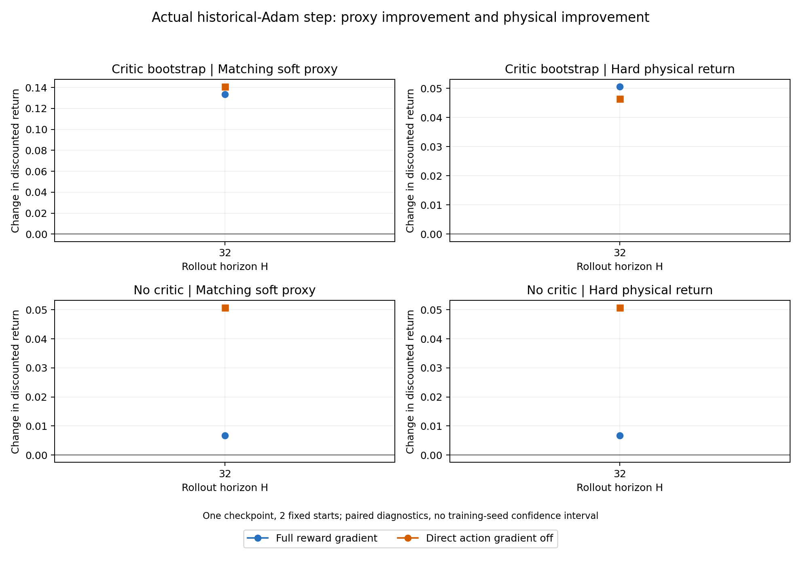
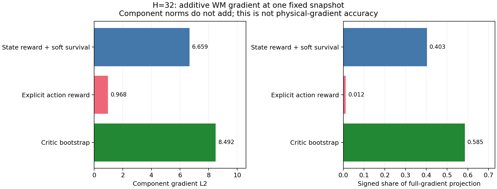

# H32：FP32 Critic／动作梯度消融与原始向量复核

补齐H32三组消融的FP32控制，与既有完整目标组成同精度2×2对照。固定对象沿用[原生15组实验](policy-gradient-native-v1.md)：一个seed0 checkpoint、两个run起点、raw history、RNG9001、H32、三种ε和真实历史Adam；只关闭TF32，AMP仍为None，原训练代码未修改。这里没有新增训练，也没有扩展状态覆盖。

## 同精度实际更新

表中L2由保存的9116477维向量在CPU FP64重算。Return是H32折扣和；这是同一起点批次上的单次实际Adam位移，不是等L2更新，也不是全motion归一化评分。

| Critic | 显式动作梯度 | 原始梯度L2 | 实际Adam位移L2 | Δ代理目标 | Δ硬物理Return |
|---|---|---:|---:|---:|---:|
| 开 | 开 | 12.377658 | 0.119039 | +0.133316 | +0.050590 |
| 关 | 开 | 6.778900 | 0.117304 | +0.006738 | +0.006751 |
| 开 | 关 | 12.268947 | 0.119334 | +0.140770 | +0.046465 |
| 关 | 关 | 6.659136 | 0.117608 | +0.050740 | +0.050749 |

关闭Critic同时改变WM和物理代理目标；关闭显式动作梯度保持前向奖励不变，只改变backward。历史Adam仍含过去的Critic影响。不能把此表当成四个从头训练算法的对照。

## 梯度由哪些项组成

用四组原始梯度构造可加分解：状态依赖奖励及soft survival路径；显式`a/a_prev`奖励偏导；末端Critic Bootstrap。完整梯度L2为12.377658，三部分L2分别为6.659136、0.967537、8.491574；L2不能直接相加。它们在完整梯度单位方向上的有符号投影份额分别为 **40.285%、1.180%、58.535%**，加法残差相对L2为 **1.398e-6**。

这说明此快照上的Critic Bootstrap对更新方向有明显贡献；**58.535%不是物理收益归因比例，更不是梯度准确率**。Bootstrap路径本身也穿过WM，闭环下显式动作项也会通过策略观测关联先前状态；本分解没有把“WM”和“Critic”变成互不相关的机制。实际Adam是历史预条件化的非线性变换，不能用此加法分解解释Adam收益。

## 精度与验收修复

“同时关闭Critic与显式动作梯度”的Adam硬物理收益从训练TF32的 **+0.027904** 变为FP32的 **+0.050749**。其原始梯度相对变化约0.410%，Adam位移相对变化约0.291%，方向cosine均超过0.99999；小的方向差异仍可能伴随可见的物理收益变化。其他三组的收益差异较小，完整数据见[精度对照CSV](../../results/ablation/policy-gradient-components-v1/analysis/precision-comparison.csv)。

此对照同时改变了训练目标计算与物理评估中Policy前向的数值精度，**尚未分离反向归约、前向推理和接触敏感性的贡献**，不能把差异单独归因于接触或模型偏差。所有原始数据都保留，没有选择更有利精度替代旧结果。

另修复了数据验收缺口：旧分析器核对CSV与原始回报，却没有充分检查保存梯度与预测方向导数的联系。现重算原始梯度范数、norm/value clipping、loss符号、方向单位长度及`gradient·direction`。五类人为损坏在修复前被错误接受，修复后被拒绝。

原生复核还暴露CPU FP32大向量归约误差：完整目标梯度的FP32范数为12.376800，FP64为12.377658；用前者重建单位方向产生约5.059e-6最大误差，用后者约3.146e-9。分析器改用FP64复核，没有放宽验收容差。旧发表的物理Return、FD和GPU更新没有改变；旧CPU范数为低精度近似，新表提供修正值。

全部 **18组** 原路径探针（12训练精度、6FP32）现已通过加强后的原始张量复核。分析进程未初始化CUDA；初次CPU审计失败日志和数值复现一并交付。三张图已目视检查；未运行不可用的figure-qa自动脚本。

## 费用与复现

新增三个GPU进程全部成功，完整分配 **147.468759秒 / 0.040963544 GPU-hours**，采样峰值2766 MiB。加上此前15组原路径和7个匹配估计器/失败/审计进程，累计 **0.351949199 GPU-hours**，沿用0.5上限。已有完整目标探针复用，未重复计费。新增CPU整体复核及绘图55.540秒；首次失败的CPU检查另行保留，不冒充GPU训练费用。

仍使用独立GPU2、CPU76–79/nice10和既有诊断缓存；分析CPU72–75/nice15。正式GPU0队列未中断；不假设共享主机干扰为零。运行前检查27.91 GiB可用磁盘并预留24 GiB，每个新进程检查空闲GPU和累计费用。

[原始日志/CSV、完整张量SHA与复算命令](../../results/ablation/policy-gradient-components-v1/README.md)。完整原生梯度与rollout张量保留a1008，小包不包含这些大张量；单凭小包可以复算表格和费用，但不能声称重做了物理实验。

已验证的是局部原路径与梯度组成、更新收益和数值敏感性。[七项要求对应的最终解释](policy-gradient-conclusions.md)区分准确性、有效性和仍缺的更广统计证据。
