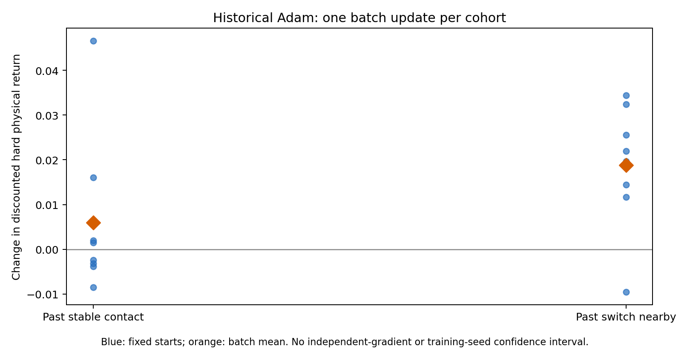
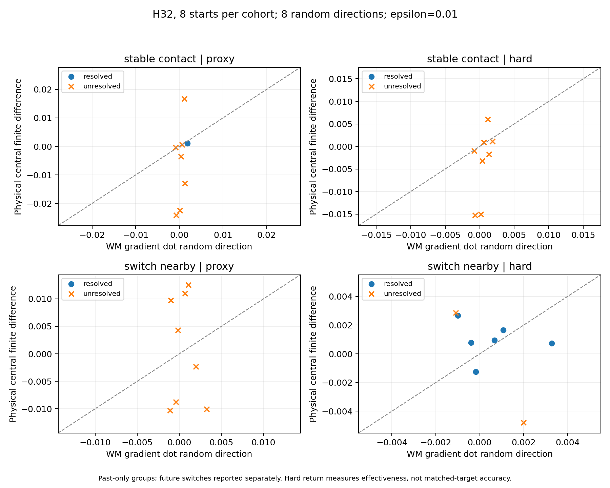

# Policy 参数梯度：接触历史分组

本实验扩展到两个各含 8 个起点的批次，使用同一个已训练 Policy/WM/Critic/Adam checkpoint，H=32、FP32、固定噪声种子 9001。每批计算其平均目标的一个完整参数梯度；8 个起点不是 8 个独立梯度样本。每批包含同样的 3 段 run、1 段 sprint、4 段 walk，具体帧不同，因此组间差异不能解释为接触状态的因果效应。

## 状态库与预先指定的选择规则

初始计划见 `experiments/ablation/configs/policy-contact-coverage.json`：在旧 64 状态库中，排除此前分析的 0/1，按库顺序选择同时包含两类接触历史的前 8 段 motion，各取每类第一个起点。选择不使用梯度或 return。接触用实际 MuJoCo-Warp 最后一个物理子步的有效 geometry pair，经 body 映射合并接触片；没有接触力或子步事件真值。

旧库缺少完整 raw replay history。64 状态重放后，最大末端偏差 0.0009658634662628174，超过保持原末端所要求的 1e-5；原计划在梯度计算前停止，失败日志和 19.541911943 秒 GPU 占用保留。没有调宽原门槛。

修订计划 `policy-contact-coverage-replay.json` 在新梯度计算前固定：用相同 reset frames 和固定 16 步 parent action tape 生成**另一个派生状态库**，记录实际 raw history、末端及接触，同时保存 parent hash、原末端和逐状态漂移。它是固定动作重放，不是重新采集的 closed-loop policy prefix，也不是旧库精确末端或历史训练 minibatch。旧库文件保持不变。重新核对原预选索引的 motion 和过去接触标签，任一改变都在梯度计算前拒绝。

`--replay-prefix-bank` 只允许和 `--prepare-history-only` 一起使用；常规参数梯度最多 16 起点的限制保持不变。旧库及派生库结果分开报告。

## 指标与解释

- 3 个归一化更新方向（raw gradient、clipped gradient、historical Adam）与 8 个随机方向；epsilon=0.001/0.003/0.01，3 次相同初始状态的 baseline 重复。
- 原始 `policy_update()` 的 H32 closed-loop reward + soft survival + critic bootstrap 为匹配代理目标；硬终止物理 return 单独报告更新有效性。
- 随机方向相关性、符号一致率按组、目标、尺度分别汇总，保留未解析方向；数值解析筛选可能造成选择偏差。不能把选定梯度方向混入随机方向相关性来抬高结果。
- 过去标签只使用保存的 prefix；起点的对称 ±2 步邻域使用未来观测补全；未来 H32 窗口标签另列。初始状态是最后一个 prefix contact，不是第一个后续状态。
- 保存全部 baseline、正负扰动和实际 Adam 的接触轨迹，以及每个起点的物理改进。一个批次梯度不复制成每个起点的独立梯度预测。

## 可复现入口

准备派生库（在检查 GPU UUID、可用显存、剩余累计预算和磁盘后执行）：

```bash
python -m experiments.ablation.fidelity --probe-space policy \
  --checkpoint "$CHECKPOINT" --bank "$PARENT_BANK" --output "$OUT/history64" \
  --sample-indices $(seq 0 63) --prepare-history-only --replay-prefix-bank \
  --record-contacts --precision fp32 --gpu 2 --gpu-uuid "$GPU_UUID" --max-seconds 75
```

每组使用同一个派生库，按配置中明确的索引运行：

```bash
python -m experiments.ablation.fidelity --probe-space policy \
  --checkpoint "$CHECKPOINT" --bank "$OUT/history64/policy-bank.pt" \
  --output "$OUT/stable_contact" --sample-indices 55 20 21 5 43 8 29 31 \
  --gradient-horizon 32 --probe-seed 9001 --directions 8 \
  --epsilons .001 .003 .01 --repeats 3 --precision fp32 --record-contacts \
  --gpu 2 --gpu-uuid "$GPU_UUID" --max-seconds 165
# switch_nearby: indices 19 2 3 41 7 44 11 13; 独立输出目录。
python -m experiments.ablation.analyze_policy_contacts \
  --root "$OUT" --plan experiments/ablation/configs/policy-contact-coverage-replay.json \
  --output "$ANALYSIS"
```

## 原生验证结果

两组均完成 70 次物理 rollout（3 baseline + 66 正负扰动 + 1 actual Adam），每次 8 起点、32 步。全部原始梯度、裁剪、unit direction、方向点积、CSV 与物理返回张量通过 CPU 复核；两组随机方向逐张量相同，state/history 从同一派生库逐值选择。

| 过去接触组 | actual Adam 硬物理 ΔReturn | 带 Critic 代理 ΔReturn | 硬回报改善的起点 | 未来 H32 出现接触切换 |
|---|---:|---:|---:|---:|
| stable_contact | +0.00600910 | +0.02717590 | 4/8 | 7/8 |
| switch_nearby | +0.01879692 | +0.06925011 | 7/8 | 8/8 |

这是每组**一个批次平均梯度**所产生的真实历史 Adam 更新。步长由原始 Adam 历史决定，位移 L2 分别 0.12004382 / 0.12121719；不是跨组等步长比较，也不是新的 BPTT/PPO 对照。stable 组有一半起点退化，因此正的平均收益不等于每个状态都改善。原始 GPU 均值差保留；从逐状态返回进行 FP64 复算，硬回报改进为 +0.00600913167 / +0.01879718900。



8 个随机方向的**匹配代理目标**结果如下；括号内给出已解析方向上的符号一致率和 Pearson r。相关性只描述保留下来的小样本，数值筛选可能造成选择偏差。

| ε | past stable：已解析/8 | past switch：已解析/8 |
|---|---|---|
| 0.001 | 2/8（2/2，r 不可报告） | 4/8（3/4，r=0.584813） |
| 0.003 | 2/8（2/2，r 不可报告） | 4/8（3/4，r=0.555045） |
| 0.01 | 1/8（1/1，r 不可报告） | 0/8（无可报告统计） |

沿 raw gradient 这个**选定方向**，ε=.003 的代理导数预测/物理差分分别为 2.871353/2.964020 和 4.522671/5.265554，方向同号且通过尺度筛选；它不代表所有随机方向。raw 与 norm-clipped 方向在本批几乎重复，不能把 CSV 中 selected-direction 的高相关性当作独立准确性证据。

硬回报随机方向在 ε=.01 下分别为 0/8 和 6/8 已解析；后者符号一致率 4/6、r=−0.115862。它与 WM 的 soft+bootstrap 目标不同，因此这个 r **不是匹配目标的梯度准确率**。[所有尺度/方向/目标的 CSV](../../results/ablation/policy-gradient-contacts-v1/directions.csv) 和 [汇总](../../results/ablation/policy-gradient-contacts-v1/metrics.csv)完整保留，没有仅选择表现好的方向。



baseline 三次重复的批次平均回报差均为零，但这不消除截断误差、浮点扰动误差或接触不光滑性。跨尺度筛选失败不能直接证明 WM 梯度错误。当前三档 ε 对多数匹配目标随机方向仍无法给出稳定参考；扩大步长也会改变“局部”问题，不能为了得到相关性而事后只挑某档结果。

## 接触解释与未证实结论

过去 stable 的 8 个状态中，1 个在补全起点未来 ±2 步邻域后变为 switch_nearby，7 个在后续 H32 窗口出现切换；真正整个 H32 无切换的只有 1 个 sprint 状态。[逐状态接触记录](../../results/ablation/policy-gradient-contacts-v1/contacts.csv)。因此当前分组验证了保存接触与分层分析的链路，不能声称“稳定接触阶段的梯度优于切换附近”。两组还存在状态/相位差异，不能把均值收益差归因于接触。

**已验证**：旧库失败时拒绝梯度、明确派生新库、保持固定历史/状态、原 actor 路径、两目标物理闭环、全部方向和原始张量复核、过去/起点/未来接触分开报告。

**观察性现象**：两组平均 Adam 更新有效，但个体收益有负值；随机方向参考对尺度敏感；过去稳定标签不能代表未来 H32 稳定。

**未证实**：总体梯度准确性排序、接触的因果作用、WM MSE 对参数梯度准确性的可预测性、跨训练seed/WM阶段的稳定性。此前两起点的[匹配 BPTT/PPO](matched-policy-results.md)仍单独解释，未把它推广为本轮16状态的PPO对照。

## 成本、复核与数据

本轮 GPU 占用：失败的旧库重建 19.541912 s；派生库 19.214651 s；stable 83.821678 s；switch 82.491977 s；合计 **205.070218 s = 0.056963949 GPU-hours**。峰值 3198 MiB。加上之前诊断，累计 **0.408913148 GPU-hours / 0.5 上限**，包含失败与准备成本。全部诊断 GPU 进程已结束，正式 GPU0 队列未中断；共享主机资源干扰未被证明为零。这些是诊断成本，不与训练 Return/Compute 曲线混合。

首次 CPU 验收因 8 元素 FP32 的 GPU/CPU 均值差不完全相等而失败。逐状态返回未改变：例如 switch 的硬改进 GPU=0.01879692078、CPU FP32=0.01879739761、CPU FP64=0.01879718900。分析器改用 FP64 参考与基于 dtype、样本数和返回量级的 reduction roundoff bound；它只界定加法/除法/相减舍入，不是仿真误差容限。实测舍入实例通过，篡改 +0.001 被拒绝；首次失败、逐值算术审计及原始 GPU 数字全部保存。完整 CPU 复核用时 12.603914 s，没有初始化 CUDA，也没有重跑物理结果。

原生代码 `40505eb8ba45d66a4c36ee22e69c72bf77cb4362`；张量分析代码 `2ce7ac33509eff3dfb3ce81b52cfbc0d3397ec9e`。两者均不改 `supermimic/`。派生库 SHA256 `e97385f252b14cfa54d0e5cfd356f48292c1f2cdec16704433138907062b74f0`。

[原始日志、状态库、CSV、接触/物理返回小包](../../results/ablation/policy-gradient-contacts-v1/raw-data.tar.gz)（27文件，5,149,098 bytes，SHA256 `4a595de68d42985259f37ab877b090bfc18bd81c2b5cecdec4464027dcc3079a`）与 [完整复核和成本收据](../../results/ablation/policy-gradient-contacts-v1/validation.json)。9M维 gradient/unit-direction/Adam 大张量仍保留实验主机，收据列出每文件 SHA 和大小；小包中的 physical 文件去除了 unit directions，足够复核物理返回与接触，不冒充完整物理重跑输入。

CPU 回归与已发布数据复算：`python -m unittest discover -s tests -v`。
