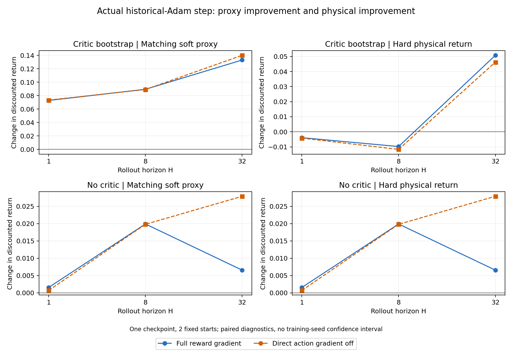
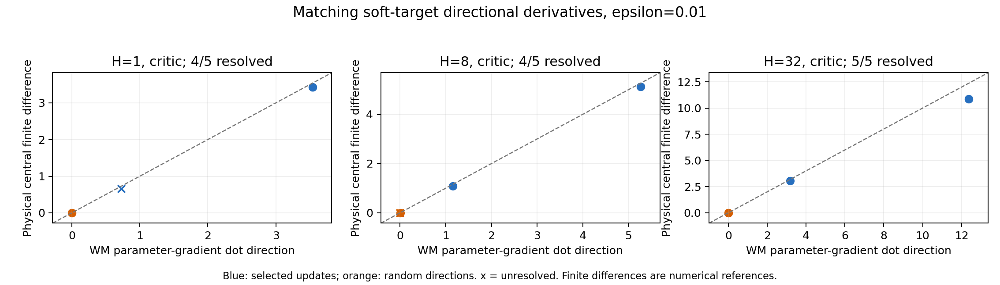

# Policy 参数梯度：15 组原生物理诊断

固定一个开发 seed0 checkpoint 和两个 run 起点，已完成 H1/8/32 × Critic 开/关 × 直接 Action Reward 梯度开/关的 12 组 MuJoCo-Warp 探针，另完成 3 组完整目标 FP32 敏感性检查。它们验证了完整策略参数梯度的测量链路，并给出下面的局部观察；**尚不能证明 BPTT 比 PPO 的梯度更准确或更有效。该15组批次不包含PPO；后续已完成[首批同目标对照](matched-policy-results.md)。**

## 固定对象与实际运行

- 执行源码：`19305b7666312e136a58a14bec07f808a315847f`，独立只读 checkout。原 `supermimic/` 未修改。
- Policy/WM/Critic/历史 Adam：开发 seed0 的 `supermimic-seed0/ckpt_004000.pt`，SHA256 `54d0854c1b4a8af9770b0c6f11c29d6ad8d0c9e6f870913e81234ac9caf0cbac`。没有重新训练 WM。
- 原 held-out bank SHA256 `a79f08f281b288e8f8001aa994fc127789c080e42b67fa809dce1cbeb48d3abb`；选择原始索引 0、1：`run1_subject2` / `run1_subject5`，frame 6540 / 12793。**只有两个 run 状态，没有代表整个 locomotion 子集。**
- 第一次重放保存的 prefix 重建 raw history；末态最大误差分别 5.3644e-6 / 5.9605e-6，低于 1e-5。其余 14 组共享完全相同的状态和 history 张量；准备好的 bank SHA256 为 `8567f64d7e316d96b0e4b0c0014af2bcedb0be85d27626ec457f2b46287291d0`。
- 诊断 RNG seed9001，2 个随机方向及 raw/clipped/Adam 三个单位方向，ε={.001,.003,.01}，每组 3 次同基线复评、30 次正负扰动、1 次真实 Adam 更新评估。每组计算的是两个起点平均目标的梯度，不能当作两个独立梯度样本。
- A100-PCIE-40GB，UUID `GPU-cc40495e-8e3b-d4c0-894a-63ce2fb079a9`（GPU2）。正式队列继续使用 GPU0；独立缓存、CPU76–79、nice10，记录并发资源快照。没有中断正式进程或修改其执行源码；共享主机上的干扰并未被证明为零。
- 15 个进程全部成功，完整进程分配累计 **610.163346 秒 / 0.169489818 GPU-hours**，低于该批次 0.25 GPU-hours 总上限；采样到的显存峰值 **2766 MiB**。包含初始化、梯度捕获和所有物理 rollout；CPU 后处理另耗 31.780645 秒，未初始化 CUDA。首个进程包含冷缓存，不能把各探针耗时差异当作算法提速。

原始 actor 语句通过 AST 提取复用，执行 eager。12 组使用 checkpoint 训练精度（TF32 开、AMP 无）；3 组 FP32 关闭 TF32。这里没有验证 eager 与 compiled CUDA 的逐值等价。已有 checkpoint 来自消融训练入口，诊断采用原训练 actor 顺序；并非历史训练 minibatch/RNG 的精确重放。详见[计算路径与解释边界](policy-gradient-fidelity.md)。

## 匹配目标的局部导数与实际更新

完整目标、训练精度、raw-gradient 单位方向，ε=.01：

| H | WM-BPTT 方向导数 | 物理中央差分 | 数值筛查 |
|---|---:|---:|---|
| 1 | 3.537588 | 3.454113 | resolved |
| 8 | 5.267631 | 5.082083 | resolved |
| 32 | 12.391531 | 10.886860 | resolved |

这是三个特定方向的数值参考，不是完整梯度向量误差或解析 Jacobian。有限差分仍受扰动尺度、精度和接触离散变化影响。

实际历史 Adam 步的平均回报变化如下。每个 H **重新计算不同的梯度与更新**，不是同一次更新的三个轨迹前缀。

| H | Critic | 直接动作梯度 | Δ软终止代理目标 | Δ硬终止物理 Return |
|---|---|---|---:|---:|
| 1 | 开 | 开 | +0.072858 | -0.003904 |
| 1 | 关 | 开 | +0.001566 | +0.001566 |
| 1 | 开 | 关 | +0.073427 | -0.004182 |
| 1 | 关 | 关 | +0.000712 | +0.000712 |
| 8 | 开 | 开 | +0.089525 | -0.009792 |
| 8 | 关 | 开 | +0.019898 | +0.019897 |
| 8 | 开 | 关 | +0.089198 | -0.011694 |
| 8 | 关 | 关 | +0.019810 | +0.019809 |
| 32 | 开 | 开 | +0.133080 | +0.050794 |
| 32 | 关 | 开 | +0.006562 | +0.006574 |
| 32 | 开 | 关 | +0.140116 | +0.046266 |
| 32 | 关 | 关 | +0.027898 | +0.027904 |

软代理目标与硬物理 Return 是不同目标：H1/H8 中前者改善、后者下降，说明不能用代理收益替代物理收益。关闭 Critic 改变了当前目标；**历史 Adam moments 仍含过去 Critic 的影响**，不能解释为完全消除了 Critic。关闭直接动作梯度只改变 backward，前向奖励不变；这一分支是 surrogate update 有效性测试，不能以完整目标的有限差分作为同目标准确率。

完整目标的 Adam 位移 L2 为 0.108262 / 0.109829 / 0.118967，与 raw 梯度的 cosine 为 0.204621 / 0.219339 / 0.257242。它明显大于扫描的最大 ε=.01，方向也经过历史预条件化；不能从小扰动导数推断这次真实步长的收益。

所有 Return 都是 H 步折扣和，不是完整 motion 的归一化 benchmark score。逐起点结果见 `per-start-updates.csv`；不把两个起点、3 次复评或多个 ε 当作训练 seed，不绘制训练 seed 置信区间。

## 数值精度敏感性

完整目标 ε=.01 的两个随机方向：训练 TF32 下 H1/8/32 共 6 个均未通过数值解析筛查；独立 FP32 检查有 5/6 个通过。三次基线重复误差均为零，并不意味着中央差分可信。TF32 下的小信号未解析不能直接归因为 WM 梯度错误。

FP32 下完整目标实际 Adam 的 Δ代理/Δ物理分别为 H1：+0.072589/-0.003913，H8：+0.089693/-0.009900，H32：+0.133316/+0.050590；在本批两个起点上，收益符号与训练精度一致。

每个条件只有 2 个随机方向，随机方向 Pearson 相关性未报告（不足最低样本数）；三个选择方向彼此相关，不能用其高相关性证明整个参数空间的梯度准确。图中叉号代表 unresolved，蓝色为选择方向，橙色为随机方向；小随机导数在全量坐标中接近原点，精确数字见 CSV。两种精度独立分析、不合并计数。

## 复核、重跑与剩余研究

[数据包说明与 CPU 复算命令](../../results/ablation/policy-gradient-native-v1/README.md)包含原始日志、450 条方向/目标/尺度记录、60 条逐起点 Adam 结果、资源收据、完整原始张量哈希及图。大张量保留在实验主机并向数据盘逐文件校验备份，没有删除远端原件。仓库中的小包不含约 7.64 GiB 的完整梯度/rollout 张量，不声称仅凭小包能重新执行物理梯度实验。

已验证：原生闭环参数扰动链路、共享状态历史、H1/8/32 与四组合消融、真实历史 Adam 位移、数值精度敏感性、原始张量与 CSV 一致性。观察性现象：这两个起点上代理与物理收益可异号，关闭 Critic 的当次更新可改善短时域物理收益。尚未证实：跨状态/接触/训练 seed 的普遍性、全向量梯度准确性，以及 BPTT 相比 PPO 的完整训练归因。

下一步先统一随机策略和期望目标，比较 reparameterized BPTT 与不穿过 WM 反传的 PPO score-function 梯度；分别量化采样方差、同物理目标的方向质量与等参数位移预算的真实改善。需要独立随机数批次作为参考，并保留当前确定性原路径结果。不能将随机 PPO 的期望梯度与确定性 BPTT 的梯度夹角直接称作准确率。
