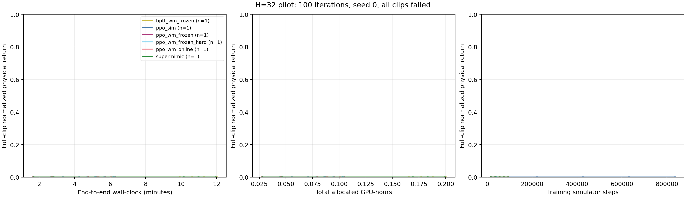
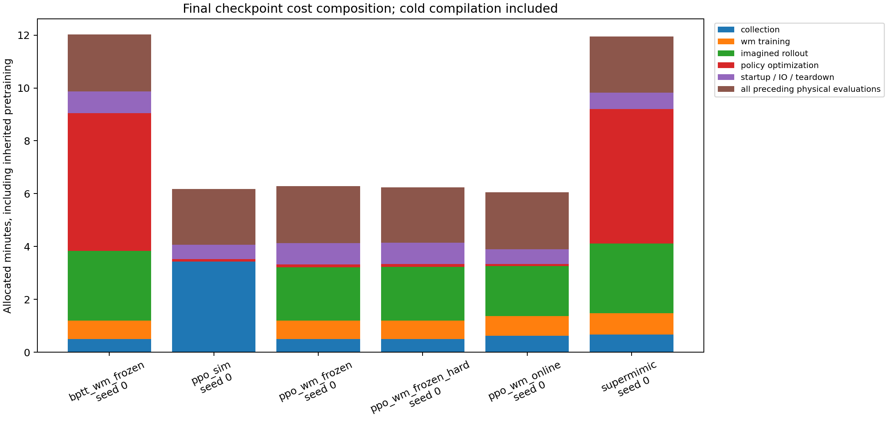
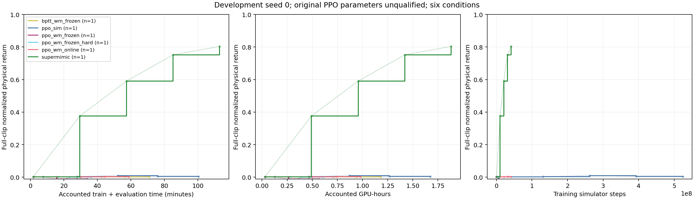
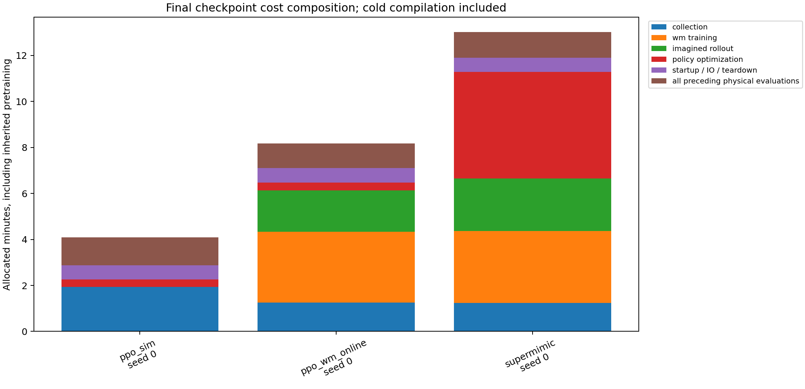
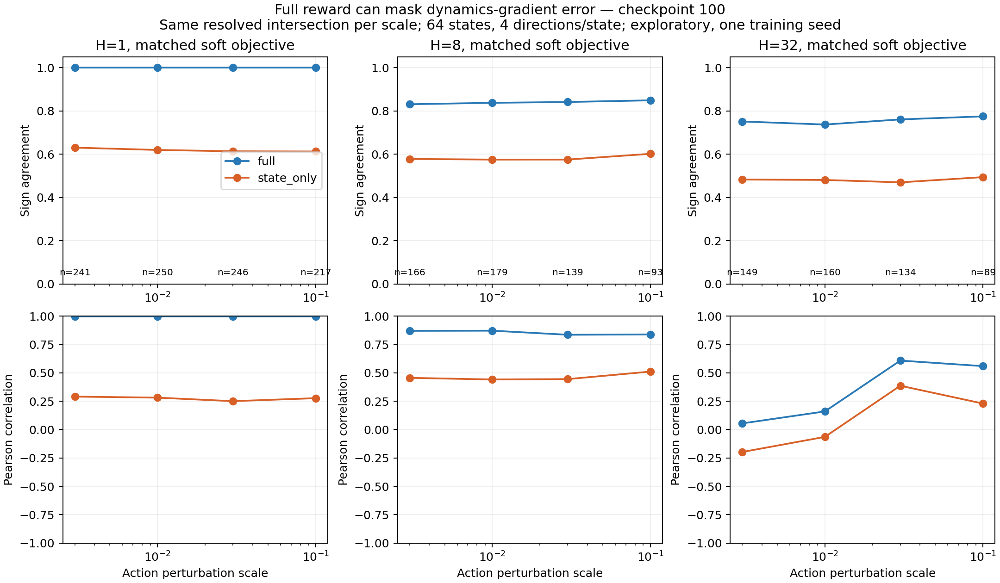
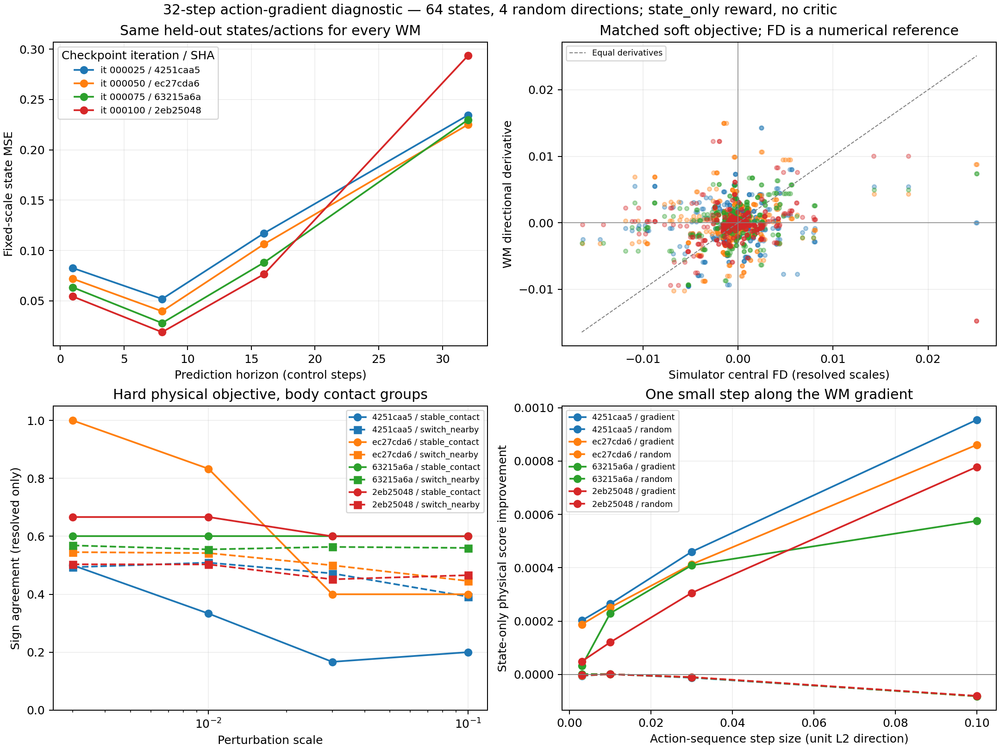
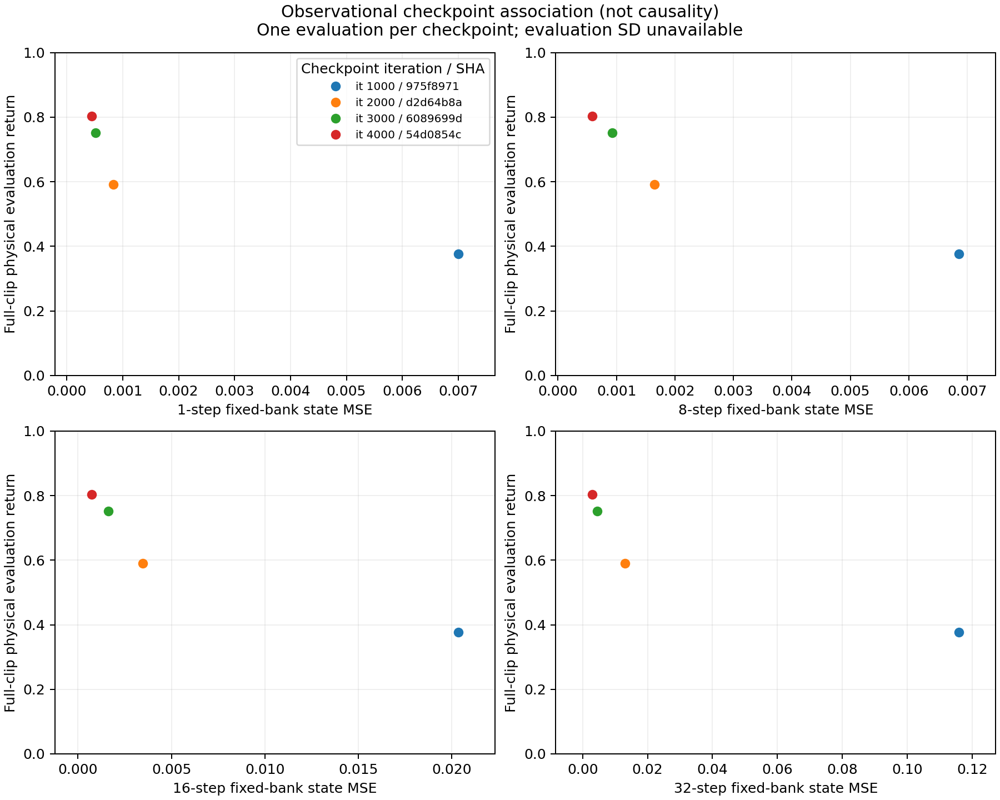
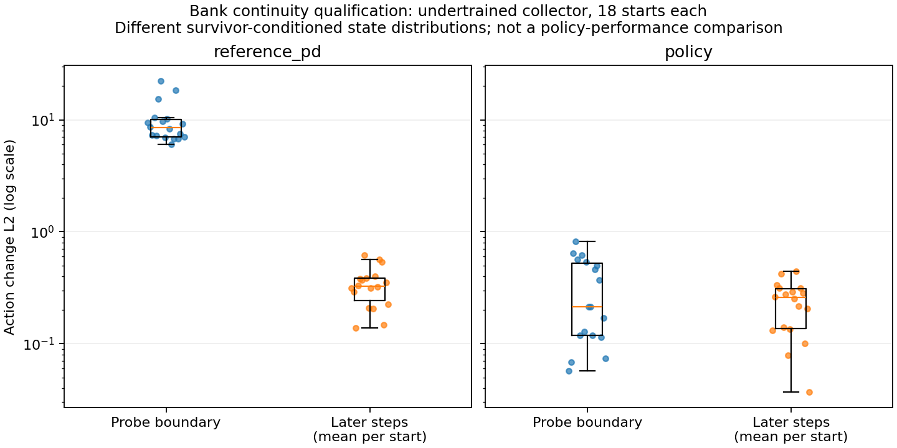
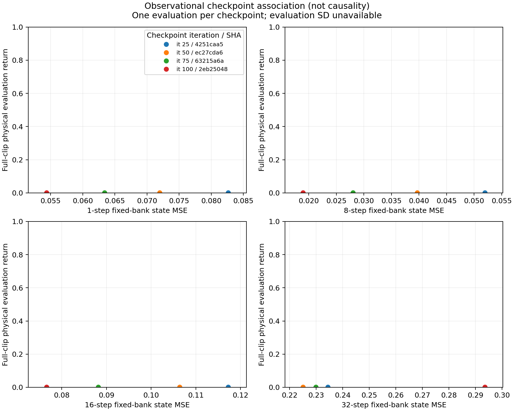
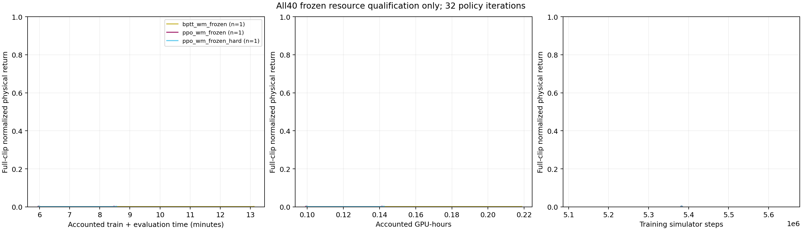

# 已验证的阶段结果（更新至2026-10-24）

新增[完整 Policy 参数梯度原生诊断](policy-gradient-native-v1.md)：15组、同一checkpoint两个run起点、0.169490 GPU-hours。分别报告匹配代理导数、实际Adam物理收益和FP32敏感性；[同策略同目标PPO梯度对照](matched-policy-results.md)亦已完成首批，含独立物理噪声与相同L2步长检验；尚无跨状态/训练seed的完整结论。

本PR已完成原生Smoke、100迭代单seed Pilot、18段及40段全部六条件的4096规模资源资格、64状态探索性梯度诊断及开发seed0的六条件4000轮矩阵。尚无完整三seed或40段正式结果；正式seed1正在运行，seeds2/3串行等待。

训练/Pilot固定提交555a051；初版数值探针e410334；配对full/state_only探针8d02575；开发seed0长程运行器30739d2；正式训练和40段资源资格固定3526437；已训练collector探针固定6dd6fd5。原supermimic目录未修改。各批次来源和费用以链接中的收据为准；当前代码测试见PR的对应提交CI，历史原生状态/FK/reset资格与CPU测试不替代正式实验结果。

| 研究问题 | 已有证据 | 尚缺的证据 |
|---|---|---|
| WM高吞吐能否抵消学习成本和偏差？ | 正式seed1两PPO方法全部完成，在线PPO-WM最终记录费用低31.52%，Return数值接近；全部采集、WM训练和评估计费 | 单seed不证明质量等价；两者未达预登记门槛，尚缺同等质量的多seed端到端成本 |
| 同一WM下BPTT比PPO高效多少？ | 冻结辅助组共享WM、replay和初始网络，内容身份已验收 | 原开发PPO参数未合格，冻结BPTT也未学会跟踪；需正式独立seed结果，仍须保留模型成熟度限制 |
| Prediction Error能否代表Gradient Fidelity？ | 固定库同时测得多步MSE、方向一致率、相关性及真实微步改善；长时域和扰动尺度影响明显 | 独立训练seed复验；动作序列方向探针不能替代带critic的完整policy参数梯度 |
| 更低Prediction Error是否带来更好Policy？ | 已训练collector的四阶段MSE与物理Return共同改善，但梯度微步收益不单调 | 排除policy、数据与训练时间共同变化的因果证据；四个checkpoint不是四个seed |

下文的完整开发矩阵、短程资格和梯度探针分别解释。早期三方法快照与完整六条件数据来自同一批运行，不重复相加计算成本。现行全40段预算只见[直接实测规划](all40-planning.md)，未采用的历史估算保留在原始文件中。

## 正式seed1的两个PPO方法已完成

PPO-Sim与在线PPO-WM各4000轮、各15次物理复评全部完成，合计540条clip记录。最终Return为0.405211548 / 0.402736068；全部训练和评估费用为3.481734781 / 2.384217185 GPU-hours。72个原始文件、8000行CSV/stdout与32个选定方法进程账本已核对。在线PPO-WM费用低31.52%，但两者都没有达到预登记Return门槛0.5/0.7/0.8；三次复评属于同一个训练seed，不报告质量等价、加速比或完整效率归因。

[对照曲线、双时间口径、全部原始数据与复算](confirmatory-seed1-ppo-pair.md)。SuperMimic及冻结组、seed2/3仍在执行或等待；原生整批张量验收仍待campaign结束。下面保留PPO-Sim的单方法细节。

## 正式seed1的PPO-Sim单方法细节

4000轮训练及五个checkpoint各三次物理复评全部完成，270条clip记录已核对。最终Return均值0.405211548、复评样本SD0.008720951；三次失败7/5/6段，平均失败率33.3333%。完整训练与全部评估3.481735 GPU-hours，不承担共享WM预训练费。最后一个checkpoint出现同身份复评差异，原因尚未定位；三次全部保留。这里是一个正式训练seed，其余四条件及seed2/3仍未完成，不能给出算法排名或训练seed标准差。

[完整曲线、原始日志/CSV、费用与CPU复算](confirmatory-seed1-ppo.md)。单方法记录验收不替代包含实际模型张量的整批原生验收或严格三seed汇总。

## 统一短程物理评估

同一A100-PCIE-40GB GPU、seed0、18段walk/run/sprint、256环境、H32、100迭代。7次训练（含pretrain）+30次物理复评，540个clip记录；实际campaign0.75351 GPU-hours。所有条件跟踪失败率100%，不能排名。最终归一化物理return约0.00146–0.00157；BPTT冷编译占短程成本很大比例。




[评估与完整成本CSV](../../results/ablation/pilot-v1/evaluations.csv)。冻结方法曲线各自计入全部预训练；实际campaign只执行一次共享pretrain。中间成本点为重建快照，最终点使用完整进程分配时间。单seed无标准差带。

## 4000 迭代探索中的PPO参数诊断

下表提取已经完成的开发seed0六条件矩阵中的三主方法，用于说明原PPO参数的问题。硬件、18段动作和评分协议一致；完整六条件终点与费用见下一节。

| 迭代 | 原PPO-Sim Return | 原在线PPO-WM Return | BPTT Return | BPTT失败数/18 |
|---:|---:|---:|---:|---:|
| 0 | 0.001492 | 0.001492 | 0.001492 | 18 |
| 1000 | 0.003371 | 0.001674 | 0.376017 | 8 |
| 2000 | 0.009728 | 0.001717 | 0.590711 | 5 |
| 3000 | 0.005257 | 0.002987 | 0.751716 | 3 |
| 4000 | 0.003055 | 0.001697 | 0.803472 | 2 |

两个原PPO条件每个点均18/18提前失败，不能把这些数值解释为算法排名。PPO-Sim 99.75% 迭代触发 KL 提前停止，通常只有少数 actor minibatch 更新。下一 minibatch 的停止不撤销上一步过大的更新。

[完整成本与评估CSV](../../results/ablation/formal-seed0-complete/evaluations.csv)。BPTT已有明显物理改善，但原PPO基线未合格，不能直接给出优化器因果收益。单seed、旧协议每点一次复评，无标准差带。[早期三条件快照](../../results/ablation/formal-seed0-partial/evaluations.csv)仅作历史追溯，不是另一组独立实验。

SuperMimic端点训练进程5123.91秒、五次物理评估进程合计1652.88秒，总计1.88244 GPU-hours；训练物理步数41,222,144，imagined步数458,752,000，评估物理步数973,548另列。最终checkpoint SHA256为`54d0854c1b4a8af9770b0c6f11c29d6ad8d0c9e6f870913e81234ac9caf0cbac`。中间点是训练快照加累计复评的回溯成本，实际评估在完整训练后执行；图轴据此标为accounted time，而非分数实际可用时间。

在同一真实 PPO-Sim 批次与 Adam 状态上，仅将 actor 学习率 2e-4 改为 5e-6，更新后的整批精确 KL 从 0.832 降到 0.013，20 次 minibatch 更新完成；归一化更新单独产生的 KL 约 1e-5。该诊断支持步长失配。后续两候选均完成1000轮和9次物理复评：lr=5e-6达到Return=0.013086、18/18失败；lr=2e-5达到0.252798、12/18失败（3次复评SD=2.198e-6），已出现有效学习。正式长程验证选用2e-5，开发seed0不计入正式seeds1/2/3。代码新增独立 `actor_lr` 配置，缺省仍继承原 `lr`。[完整诊断、原始数据与复现命令](ppo-qualification.md)。

## 开发seed0的六条件矩阵完成

2026-10-24 02:46完成原生验收：7次训练（包括一次共享WM预训练）、30次物理评估，共37个成功子进程，实际6.678393 GPU-hours，未超过原14 GPU-hours上限。原资源门禁中断记录保留；恢复使用原30739d2训练源码和已存在checkpoint，没有重训或重置预算。

| 第4000轮方法 | 物理Return | 失败数/18 | 单独运行的训练及评估GPU-hours |
|---|---:|---:|---:|
| PPO-Sim（原参数） | 0.003055 | 18 | 1.674874 |
| PPO-WM online（原参数） | 0.001697 | 18 | 0.980082 |
| SuperMimic | 0.803472 | 2 | 1.882443 |
| PPO-WM frozen hard（原参数） | 0.000485 | 18 | 0.607807 |
| PPO-WM frozen soft（原参数） | -0.011339 | 18 | 0.565257 |
| BPTT-WM frozen | 0.001907 | 18 | 1.184420 |

每个冻结条件的成本都独立计入完整WM预训练；实际campaign只预训练一次，因此表中方法成本之和不等于campaign账本。每个checkpoint仅一次物理复评，不能报告训练seed标准差；4000轮也不等于相同计算预算。



[30个评估点与成本CSV](../../results/ablation/formal-seed0-complete/evaluations.csv) · [完整进程账本](../../results/ablation/formal-seed0-complete/campaign.json) · [原生验收](../../results/ablation/formal-seed0-complete/validation.json)。旧三条件部分结果保留为历史快照。

冻结BPTT使用500轮预训练的固定WM/replay，训练过程中没有新增模型拟合和物理采集。即使采用BPTT，它也未得到有效物理跟踪；固定模型及数据覆盖可能限制效果，但本组实验不能区分模型成熟度、分布偏移和优化设置的影响。原PPO参数未合格，不能把表中差距直接归因于BPTT收益或给出算法加速比。正式seeds1/2/3沿用已经预登记的设置和预算，独立复验，不以该开发结果调整正式批次。

正式seeds1/2/3使用固定3526437训练源码，与分析代码分离；旧seed0不计入正式均值/标准差。实际完成范围由各批次的训练、物理复评和进程账本共同确定，不能从队列配置或已写出的checkpoint推断整批实验完成。

seed1的PPO-Sim前段与GPU2的40段资源测试在同一主机重叠运行。物理GPU身份一致性门禁不能证明CPU/磁盘完全隔离；现有证据也不能量化这部分干扰。保留原始费用和该运行范围，不从时间中扣除估算干扰，不事后删除seed；后续效率结论需报告这一限制，并检查各训练seed的成本一致性。

## 全部40段目标规模资源实测

2026-10-24完成，固定训练源码3526437、资源脚本f6cd2c7、GPU2（A100-PCIE-40GB），4096环境、H32、k8、seed0。独立pretrain500轮；PPO-Sim32轮；在线PPO-WM和SuperMimic各500轮模型预热加32轮策略更新。4个训练进程加6次完整物理评估，共240条逐clip记录，实际0.533098 GPU-hours，低于原3.2上限。

| 方法 | 训练进程秒数 | 两次物理评估秒数 | 训练/评估GPU-hours | 峰值显存MiB | 最终物理Return |
|---|---:|---:|---:|---:|---:|
| PPO-Sim | 172.957 | 72.804 | 0.068267 | 8710 | 0.0016694 |
| PPO-WM online | 425.830 | 64.840 | 0.136297 | 12718 | 0.0016776 |
| SuperMimic | 714.275 | 66.990 | 0.217018 | 23918 | 0.0020213 |

独立WM预训练另花401.457秒（0.111516 GPU-hours，峰值7916 MiB），保留在实际总账中；PPO-Sim没有加载或承担它，在线两方法也没有复用它。三个最终策略均40/40失败。这是资源资格，不是控制效果或样本效率排名。

| 最后30个暖态更新 | PPO-Sim | PPO-WM online | SuperMimic |
|---|---:|---:|---:|
| 平均完整迭代秒数 | 1.91855 | 1.29198 | 1.19822 |
| 每迭代Actor更新数 | 20 | 20 | 1 |
| 物理采集steps/s | 102097 | 108210 | 109978 |
| Imagined rollout steps/s | 不适用 | 435976 | 358670 |

计数和计时取同一30个区间的差值。完整暖态迭代包含各方法实际执行的采集、WM拟合、rollout及策略优化；吞吐分母仅为对应phase。PPO和BPTT的单迭代更新机制不同，不能把迭代秒数之比解释为优化效率。这里观察到WM rollout的高吞吐，同时短批次在线WM总成本较高；仍须比较达到相同物理表现所需的端到端成本。测量与本主机其他GPU工作有重叠，不是隔离硬件基准。



[物理Return与成本曲线](../../results/ablation/all40-resource-v1/return-compute.png) · [逐进程费用/显存](../../results/ablation/all40-resource-v1/process-allocations.csv) · [暖态phase计时](../../results/ablation/all40-resource-v1/warm-resources.csv) · [原始来源哈希与验收摘要](../../results/ablation/all40-resource-v1/qualification.json)。用保存的原始目录重建：

```bash
python results/ablation/all40-resource-v1/reproduce.py /path/to/all40-resource-v1
```

三种冻结条件的目标规模资格也已完成，实际0.340834 GPU-hours；共享一份新的500轮pretrain，各32轮策略更新及初始/最终物理评估。其预训练成本与上表的独立预训练分开记录，详见[冻结组实测](#全部40段冻结wm资源资格完成)。复现命令见[运行手册](runbook.md#全部40段冻结条件的资源资格)，不表示需要重跑已完成批次。

40段与18段最长参考轨迹均为13655步，但成功跟踪时40个仿真槽的实际吞吐不能由18段直接推断。接入冻结组直接实测后，六条件各4000轮、五个checkpoint、每点三次复评的单seed规划为59.174996 GPU-hours；其中每次评估1500秒仍是假设额度。该规划未采用、未启动，不是已花费时间或性能预测。旧约57.79 GPU-hours还使用不同预训练来源，不能直接把差额归因于算法；[同口径对照和CPU复算](all40-planning.md)保留全部依据。成熟40段策略的物理评估耗时与新的资源预检仍是正式扩展的前提。

## 奖励项对梯度诊断的混杂

同一64状态/动作库、4个WM阶段、4随机方向/状态、4扰动尺度；matched soft与硬物理目标分列。FD是尺度依赖的数值参考。起点漂移最大1.19e-7；未通过噪声/尺度稳定性筛选的方向保留为unresolved。

checkpoint100、ε=.03、双方resolved交集：H1 n=246/256，full/state-only符号一致率1.000/.614，Pearson .997/.250；H8 n=139，一致率.842/.576；H32 n=134，一致率.761/.470。完整奖励包含可直接解析的动作平滑项，高一致率不能独立证明动力学梯度可靠。



[所有阶段/尺度/接触组的配对统计](../../results/ablation/paired-components/paired-gradient-metrics.csv)。state-only是诊断后新增的辅助控制，不修改训练/主评估reward。采样库由参考PD切换到欠训练collector，首步动作跳变平均L2=9.45，放大了动作项；不能把结果外推至成熟策略。

body接触定义下H1/8/32分别22/14/3个稳定起点；geom接触斑块层级没有稳定组，两个定义都保存。H32稳定样本太少，不做显著性结论。所有方向复用64个状态，不能当独立训练seed。



H32、ε=.03沿full奖励WM梯度微步的真实硬物理累计回报平均改善+.0010034；这不是完整motion归一化return，也不是policy参数更新后的学习效果。state-only辅助分数改善+.0003060另报。

## 后续与资源

18段4096环境实测峰值PPO-Sim8450MiB、在线PPO-WM12422MiB、BPTT23638MiB；40段实测另见上节。历史单seed六条件4000轮估算8.52–10.77 GPU-hours未包含充分Actor更新与每点三次复评，已不用于正式批次。开发seed0最终在原14 GPU-hours上限内完成，实际6.678393 GPU-hours；保留原资源门禁中断及恢复记录。4000轮不保证收敛。

历史评估时长按30–300秒估算，但BPTT第1000轮的完整物理评估实际396.49秒。新PPO候选复评实际395–407秒，在线PPO-WM的500轮预热加32轮完整更新资格共0.161523 GPU-hours；已据此将18段正式seeds1/2/3重新估算为94.17 GPU-hours，分seed上限32、合计96，显存预留27.7 GiB。当前正式seed1已启动，seeds2/3串行等待，每批重查资源。详见[PPO资格与预算](ppo-qualification.md#两候选完成与正式参数冻结)。

已训练collector的首组固定库梯度分析见下节，多seed结论仍待执行。复现见[runbook](runbook.md)，因果边界/剩余算法差异见[protocol](protocol.md)，固定环境见[environment](environment.md)。完整原始日志、接触baseline、数据manifest和报告交付于本任务outputs。活动checkpoint保留远端；旧Smoke/Pilot的49文件及三份已完成bootstrap分两批经SHA256校验归档，共52文件、17.360 GiB。两次归档不重叠，源文件释放记录与其余文件未变的验收分别保存。[bootstrap清单](../../results/ablation/checkpoint-storage/retired-bootstraps.csv)和[选择性恢复命令](runbook.md#已完成checkpoint的归档与恢复)明确哪些原生重验需要先恢复；日志历史路径不改写，CSV/JSON分析无需恢复大型权重。没有合并本PR，也没有宣称最终研究完成。

## 已训练策略的固定库：前向误差降低，长时域梯度仍需独立检验

2026-10-24完成六个新探针：固定预先选定的最终4000轮collector（物理Return=0.803472，仍2/18失败），64个参考起点经16步连续policy前缀，probe seed=9001；同一状态/动作/名义物理参数库比较WM第1000/2000/3000/4000轮。full/state_only × H1/8/32，每探针1024条prediction及10240条gradient记录。GPU2共0.188922 GPU-hours，与主训练同主机重叠，成本另列；不是吞吐排名数据。

执行源码6dd6fd5，bank SHA256=`a79f08f281b288e8f8001aa994fc127789c080e42b67fa809dce1cbeb48d3abb`。全部探针内容身份与记录检查通过；初态最大漂移1.192e-7，首动作重放最大误差9.537e-7。边界/后续动作变化均值0.748/0.626，前缀一轮采集成功；这是参考起点的条件采样，仍不是平稳on-policy分布，也不是未见motion泛化。

| WM迭代 | 1-step MSE | 8-step MSE | 16-step MSE | 32-step MSE | 同checkpoint物理Return |
|---:|---:|---:|---:|---:|---:|
| 1000 | 0.007002 | 0.006863 | 0.020342 | 0.115979 | 0.376017 |
| 2000 | 0.000829 | 0.001645 | 0.003458 | 0.013098 | 0.590711 |
| 3000 | 0.000513 | 0.000931 | 0.001627 | 0.004460 | 0.751716 |
| 4000 | 0.000442 | 0.000589 | 0.000730 | 0.003024 | 0.803472 |

MSE来自full-H32的同一固定库预测，采用协议中的固定分量尺度，不是论文原始MSE。四阶段的MSE与策略表现共同改善，但WM、policy和训练数据同时成熟，这个观察不能证明MSE降低导致策略改善。每checkpoint旧协议仅一次物理评估，无评估标准差；四个阶段不是四个独立训练seed。



第4000轮、ε=.03、matched soft目标，full/state_only使用双方均resolved的同一随机方向交集：

| 梯度时域 | 交集方向数/256 | full符号一致率 | state-only符号一致率 | full Pearson | state-only Pearson |
|---:|---:|---:|---:|---:|---:|
| 1 | 249 | 0.936 | 0.900 | 0.966 | 0.941 |
| 8 | 199 | 0.864 | 0.874 | 0.868 | 0.869 |
| 32 | 140 | 0.664 | 0.664 | 0.094 | 0.295 |


短时域的一致性明显高于H32；H32的结果对扰动尺度也敏感，完整图保留四个尺度及各自分母。不能把未resolved方向判作错误，或把筛选后的140个方向称作独立样本。这组结果说明前向误差与方向质量需要分开测量；不证明BPTT训练无效，因为此探针是有限时域动作序列方向、无critic，和训练中的policy参数梯度并不相同。

H32、full目标、ε=.03，沿各WM单位梯度方向微步的真实硬目标累计回报改善均值（64状态、含负改善）依次为+0.00000304、+0.00023420、+0.00096606、+0.00077143。第4000轮同尺度随机单位方向为−0.00004468；其四尺度梯度微步均值为+0.00007150/+0.00003824/+0.00077143/+0.00209790。3000→4000的MSE下降未带来该局部微步指标的单调改善，但没有独立训练seed置信区间，不能声称差异显著。这些值不是全motion归一化Return，也不是重新训练后的policy improvement。

接触分组的状态数：H1稳定/切换=35/29，H8=17/47，H32=3/61。H8、ε=.03、state-only在稳定/切换组的符号一致率为0.922/0.852，双方resolved方向64/135；仅是该条件下的观察。H32稳定组只有3状态，不能据此做可靠的接触因果结论；geom原始接触记录也保留。

[全部阶段/尺度/接触组CSV](../../results/ablation/trained-policy-fidelity-seed0-v1/paired-gradient-metrics.csv) · [MSE与物理Return CSV](../../results/ablation/trained-policy-fidelity-seed0-v1/gradient-components-full-h32/prediction-performance.csv) · [校验、来源与成本收据](../../results/ablation/trained-policy-fidelity-seed0-v1/analysis-receipt.json)。


## 连续策略前缀与状态库内容验收

新增policy roll-in保持同一collector、previous action和观测历史跨越探针边界，reference_pd保留原切换控制。四个原生探针（两模式×full/state_only）均完成，18起点/模式、checkpoint100、H1、1个随机方向、eps=.01/.03，合计0.0338113 GPU-hours；每探针72条prediction、144条gradient记录。首动作从保存的状态/历史重放，最大误差2.384e-7；物理初态最大漂移1.192e-7。44项CPU测试通过。

参考PD模式的边界动作L2变化均值9.8799、后续变化均值0.3391；policy模式分别0.3210/0.2359。两组存活筛选分别重放3/2轮，状态分布不同，不能把这两个均值之差当作同状态因果效应或策略性能改善；collector仍欠训练。这组证据只验证连续历史、记录、内容身份和原生FD链路，不替代成熟策略实验。运行在GPU2，与主训练同主机重叠，成本单列。

配对检查的旧路径判断缺陷已由回归测试复现：同一路径但不同内容未被拒绝、两个未标识新库被当作配对。修复后新记录必须匹配bank SHA256、前缀和物理GPU UUID；旧路径证据显式标记legacy_path_only，不补造历史哈希。



[验收摘要](../../results/ablation/policy-bank-smoke-v1/qualification.json) · [逐状态动作变化](../../results/ablation/policy-bank-smoke-v1/bank-diagnostics.csv) · [同库配对梯度统计](../../results/ablation/policy-bank-smoke-v1/paired-gradient-metrics.csv)。原始探针收据、状态库、CSV和日志保留在交付数据包。解包后可重绘：

```bash
python results/ablation/policy-bank-smoke-v1/reproduce.py /path/to/policy-bank-smoke-v1
```

## Prediction Error与物理表现的重复评估汇总

修复了绘图入口按checkpoint覆盖复评、只取最后一条Return的问题。实际Matplotlib入口回归测试中，三次Return为0.2/0.4/0.9，旧输出0.9，修复后均值0.5、样本标准差0.360555，缺失第三次复评时拒绝绘图；46项CPU测试通过。该修复不改变已有单次评估的物理分数。

已有欠训练Pilot四个WM checkpoint重新生成1/8/16/32步误差与物理Return的关联图。每点只有一次旧协议评估，标准差明确为空；没有补造复评或训练seed。图中物理表现仍接近失败下限，不能用四个相关checkpoint推断MSE的因果作用。



[逐点CSV](../../results/ablation/prediction-performance-v2/prediction-performance.csv) · [分析输入收据](../../results/ablation/prediction-performance-v2/analysis-receipt.json)。

## 全部40段的原生 Smoke（2026-10-24）

独立版本3526437、A100 GPU2、seed0完成全部40段输入与六条件链路检查：pretrain 1轮，其余各3轮，共7个训练进程、12次完整物理评估、480条逐clip记录，总0.1975698225 GPU-hours。原生验收核对Actor更新、冻结WM不变、bootstrap成本、checkpoint身份与动作覆盖。所有策略均40/40失败；这仅证明全量动作链路可执行，不是40段正式训练，也不进入18段性能或吞吐比较。

[CSV](../../results/ablation/all40-smoke-v1/evaluations.csv) · [Return/Compute图](../../results/ablation/all40-smoke-v1/return-compute.png) · [验收记录](../../results/ablation/all40-smoke-v1/validation.json)。4096环境的[主方法](#全部40段目标规模资源实测)与[冻结条件](#全部40段冻结wm资源资格完成)资源测量已完成；正式全量扩展仍需成熟策略评估耗时、资源预检与至少3个独立训练seed。

## 全部40段冻结WM资源资格完成

2026-10-24 03:26核验：固定3526437源码、同一A100 GPU2、4096环境、H32、k8、seed0，新pretrain500轮，hard/soft PPO和BPTT各32轮策略更新。4次训练、6次物理评估共240条clip记录全部通过原生验收；实际0.340834 GPU-hours，低于预估2.4141和硬上限2.5。该短批次不是正式效果实验。

| 冻结条件 | 策略训练进程秒数 | 两次物理评估秒数 | 含完整预训练的独立GPU-hours | 峰值显存MiB | 最终物理Return |
|---|---:|---:|---:|---:|---:|
| PPO hard | 153.899 | 68.351 | 0.142340 | 10030 | 0.00164279 |
| PPO soft | 152.633 | 65.519 | 0.141202 | 10030 | 0.00164184 |
| BPTT soft | 429.462 | 66.965 | 0.218500 | 23030 | 0.00047451 |

各策略均40/40失败。共享预训练花290.173秒（0.080604 GPU-hours），每条独立方法曲线全额计入；三个端点成本之和减去两份重复预训练，等于实际campaign总账。训练进程时间包含首次编译和初始化，不能用暖态吞吐替换完整费用。最后30轮hard/soft PPO每轮均20次Actor更新，BPTT每轮1次；完整暖态迭代均值分别0.916/0.903/0.835秒。不同更新器的一次迭代不代表相同优化工作量。

额外CPU验收直接读取实际checkpoint：三条件初始Actor的26个、Critic的9个、WM的20个state_dict张量逐项与同一bootstrap完全相等；最终WM及归一化状态也完全相等。bootstrap完整文件SHA256一致，初始log-std相等，物理采集与WM训练账本无新增。共同输入replay文件不意味着三条件采到了相同rollout。CPU检查未初始化CUDA；改动权重、归一化统计、dtype或缺键均会拒绝。模型内容的冻结验收与方法控制效果分开报告。



[评估CSV](../../results/ablation/all40-frozen-resource-v1/evaluations.csv) · [进程费用CSV](../../results/ablation/all40-frozen-resource-v1/process-allocations.csv) · [原生资格](../../results/ablation/all40-frozen-resource-v1/validation.json) · [实际张量身份收据](../../results/ablation/all40-frozen-resource-v1/frozen-identity.json)。此批与正式seed1在同主机重叠，保留时间干扰限制；没有独立训练seed标准差。当前资格结束后，正式18段三seed矩阵运行期间不再主动追加GPU资源测试。40段正式训练仍待成熟策略评估耗时和剩余资源核验。
