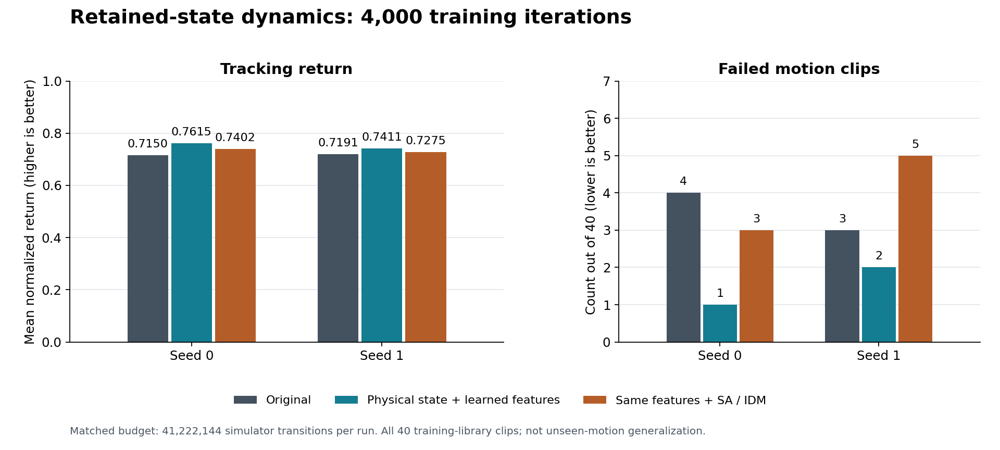

# Grounding the dynamics representation

Across two tested seeds at the same 4,000-iteration budget, retaining physical
inputs and appending learned features improved mean tracking return by 4.78%,
with failures falling from 7/80 to 3/80 evaluations. Use
`--wm_latent_dim 128 --wm_state_skip` with auxiliary weights zero. The tested
SA/IDM weights did not add benefit; [results and limits](#retained-state-result-two-seeds)
are recorded below.

This experiment transfers the **state alignment and inverse dynamics objectives**
from [GAWM](https://github.com/zsibot/gawm/blob/c8e50746e4f21c660d6dfaec97d5164db541b1e6/train.py)
to SuperMimic's state-based dynamics model. It is not a port of GAWM's visual JEPA
or CEM planner. SuperMimic already supervises physical state predictions; adding
a second copy of that loss without a shared learned representation would not
transfer GAWM's mechanism.

An optional encoder maps the existing heading-invariant state features to a
latent vector. With `--wm_state_skip`, the dynamics MLP retains the original
normalized physical inputs and appends the learned vector. Without that flag,
the vector replaces the physical state features, preserving the first experiment's
checkpoint layout. The dynamics MLP also receives the executed action and
physical context, and predicts the original frame-local state increments. Two
training-only heads regularize the encoder:

- State alignment: decode the normalized successor state features from the pair
  of current and successor encodings.
- Inverse dynamics: decode the normalized **executed action** from that same pair
  and physical context. Context accounts for randomized actuator offsets. The
  encoder and inverse head never receive the target action as an input.

Both objectives backpropagate into the state encoder used by the dynamics
model. They use real replay transitions, including the terminal successor before
an automatic reset. Transitions after the first termination in a sampled window
are masked using the existing replay mask. Feature and action normalization uses
the existing input statistics, without a second competing normalizer.

The physical rollout loss, integration, actor, critic, reward, termination,
control rate and evaluation protocol are unchanged. Policy optimization still
freezes the dynamics parameters while differentiating through its state and
action inputs. Auxiliary heads are absent from policy deployment.

## Pilot evidence and current hypothesis

A seed-0 pilot at commit `ebff203` trained each condition for 1,000 iterations
using 512 environments, world-model batch 256 and policy batch 512. All used
1,312,768 simulator transitions and the unchanged full-40-clip evaluation:

| Model | Normalized return | Failed clips |
|---|---:|---:|
| Original | 0.4309 | 15/40 |
| Encoder replacing physical inputs | 0.3963 | 19/40 |
| Same encoder with SA=0.1 and IDM=0.1 | 0.3954 | 20/40 |

Neither encoder variant improved tracking in this pilot. On identical native
reference-PD probes, normalized 8-step prediction error was 8.84, 26.29 and
25.07 respectively. The common probe uses the same target scales and transitions
for every model. It samples the training motion library, so it does not measure
unseen-motion generalization. [Full scores and configuration](../results/gawm-pilot/summary.json).

## Retained-state result: two seeds

The recommended tested configuration is `--wm_latent_dim 128 --wm_state_skip`,
with both auxiliary weights left at zero. The original model remains the default
for checkpoint and behavior compatibility.

Each condition trained from scratch at commit `8500ba4` for 4,000 iterations with
4,096 environments, world-model batch 2,048, policy batch 4,096 and 41,222,144
simulator transitions per run. Seed 0 selected the candidate after the first pilot;
seed 1 repeated all three conditions without changing their hyperparameters.
Evaluation used all 40 clips and the original failure criteria:

| Model | Seed 0 return / failures | Seed 1 return / failures | Mean return | Failures across 80 evaluations |
|---|---:|---:|---:|---:|
| Original | 0.7150 / 4 | 0.7191 / 3 | 0.7171 | 7 |
| Physical inputs plus learned features | **0.7615 / 1** | **0.7411 / 2** | **0.7513** | **3** |
| Same inputs with SA=0.1 and IDM=0.1 | 0.7402 / 3 | 0.7275 / 5 | 0.7338 | 8 |



Keeping physical inputs and appending learned features improved return by 6.50%
(seed 0) and 3.07% (seed 1), with fewer failures in both. The mean return improvement
was 4.78%. Adding the auxiliary losses reduced return relative to the same
representation without them in both seeds; seed 1 also failed more clips than the
original. These results support the retained-state representation at this budget,
but do **not** support enabling these auxiliary weights.

At the predeclared 2,000-iteration checkpoint, returns were 0.5403 / 0.5516 / 0.5544
for seed 0 (12 / 12 / 12 failures), and 0.5419 / 0.5469 / 0.5488 for seed 1
(13 / 13 / 12 failures). Both checkpoints and every clip score are retained in
[seed 0](../results/gawm-retained-state/seed0.json),
[seed 1](../results/gawm-retained-state/seed1.json) and the
[comparison summary](../results/gawm-retained-state/comparison.json).

The common-input diagnostic scored all 12 checkpoints on the same native
transitions and normalization scales. For reference-PD actions, final 8-step MSE
at iteration 4,000 was:

| Model | Seed 0 | Seed 1 |
|---|---:|---:|
| Original | 1.0691 | 1.1114 |
| Physical inputs plus learned features | 0.9968 | 0.7829 |
| Same inputs with SA=0.1 and IDM=0.1 | 1.0328 | 0.9396 |

The recommended configuration reduced the two-seed mean of this diagnostic by
about 18.4%. The probe uses four reference starts per clip, eight steps, and both
reference-PD and noisy reference-PD actions; it is separate from policy tracking.
[Complete probe scores, checkpoint hashes and scorer checks](../results/gawm-retained-state/common-probe.json).

Observed training times averaged 33.1 / 35.7 / 38.1 minutes, respectively. The
recommended configuration took about 7.9% longer in these runs. Runs shared host
CPU/cache resources, so this is not an isolated speed measurement. Mean peak
allocated PyTorch memory was about 13.45 / 13.65 / 13.65 GB; this excludes simulator
allocations. All conditions used RTX 5090 32GB GPUs.

These are two training seeds on the training motion library, not an unseen-motion
or real-robot evaluation. The 80 evaluations reuse the same 40 clips across seeds.
This is a system comparison, without a parameter-matched capacity ablation; the
original and augmented architectures consume different initialization RNG
sequences. The two augmented conditions share architecture and initialization at
each seed. Do not interpret these results as a reproduction of the upstream
README's 14,000-iteration result or as a statistical robustness guarantee.

## Compare retained-state features

Use the setup and data preparation in the repository README. The original model
remains the default and accepts the original checkpoint parameter layout.
The middle configuration is the recommended result above. The auxiliary variant
is retained for reproducible comparison:

```bash
# Original physical-state MLP
python supermimic/train.py --log_dir logs/original --seed 0

# Physical inputs plus learned features, without auxiliary supervision
python supermimic/train.py --log_dir logs/latent --seed 0 \
  --wm_latent_dim 128 --wm_state_skip

# Same representation with both GAWM-inspired objectives
python supermimic/train.py --log_dir logs/grounded --seed 0 \
  --wm_latent_dim 128 --wm_state_skip --wm_state_weight 0.1 --wm_idm_weight 0.1
```

Apply identical overrides for environment count, batch sizes, replay capacity,
number of updates and collection budget to all three conditions. The latent and
grounded conditions have identical architecture and initialization at a given
seed. The original condition is a system comparison: its architecture and random
initialization consumption differ. For loss attribution, compare the latter two.

`train_log.csv` retains its original columns and physical rollout loss semantics.
`grounding_log.csv` records the state and inverse-dynamics losses separately. Each
loss averages over feature dimensions, sums valid steps and divides by batch size,
just like the physical rollout objective. Reported values divide by window length.
Checkpoint arguments record architecture and loss weights; peak allocated and reserved
PyTorch GPU bytes are also saved (these do not include simulator allocations). When resuming, pass
matching arguments, including `--wm_latent_dim`, `--wm_state_skip` and the grounding weights.
Replay is not checkpointed, so a resumed run collects a fresh warm-up buffer.

Evaluate with the existing `supermimic/evaluate.py`: all 40 clips, first-frame
starts, no observation/action noise or domain randomization, original failure
thresholds. A lower auxiliary loss alone is not evidence of improved tracking.
Report per-clip failures and normalized return alongside measured training time,
peak GPU memory and sample counts. Short runs do not establish the README's
original 0.82 return / 40-of-40 target or real-robot performance.

## Reproduce the matched comparison

After the README setup, run inside the same Isaac Lab environment. This example
uses the exact comparison budgets; repeatability is bounded by GPU/runtime
nondeterminism. Sequential execution will have different CPU contention from our
parallel runs, so do not expect the same wall times.

```bash
for seed in 0 1; do
  common=(--iterations 4000 --num_envs 4096 --buffer_steps 1000
          --wm_batch 2048 --pi_batch 4096 --wm_only_iters 500
          --ckpt_every 2000 --log_every 100 --seed "$seed")
  python supermimic/train.py "${common[@]}" --log_dir "logs/full-original-seed$seed"
  python supermimic/train.py "${common[@]}" --log_dir "logs/full-skip-latent-seed$seed" \
    --wm_latent_dim 128 --wm_state_skip
  python supermimic/train.py "${common[@]}" --log_dir "logs/full-skip-grounded-seed$seed" \
    --wm_latent_dim 128 --wm_state_skip --wm_state_weight 0.1 --wm_idm_weight 0.1
  for condition in original skip-latent skip-grounded; do
    python supermimic/evaluate.py --run_dir "logs/full-$condition-seed$seed"
  done
done

python tools/check_shared_dynamics.py \
  --checkpoints logs/full-{original,skip-latent,skip-grounded}-seed{0,1}/ckpt_00{2,4}000.pt \
  --output logs/common-probe.json

python tools/plot_grounding_results.py \
  results/gawm-retained-state/seed0.json results/gawm-retained-state/seed1.json \
  --output results/gawm-retained-state/comparison.png
```

The probe saves its input tensors alongside the JSON and checks zero error for
identical states and the expected RMSE for a one-metre translation. Its JSON binds
scores to the checkpoint and scorer SHA-256 hashes. The plotting command redraws
the published scores; it does not collect new measurements.

## Checks without Isaac Lab

State tensor operations and replay are independent of simulator imports. With
PyTorch installed, run:

```bash
python -m unittest discover -s tests -v
SM_TEST_DEVICE=cuda SM_TEST_COMPILE=1 python -m unittest discover -s tests -v
```

GitHub Actions runs the CPU tensor checks. The CUDA compile check requires a C compiler and the matching CUDA-enabled
PyTorch environment. Checks cover checkpoint compatibility, gradient paths,
action-input isolation, heading invariance and terminal/reset handling.
